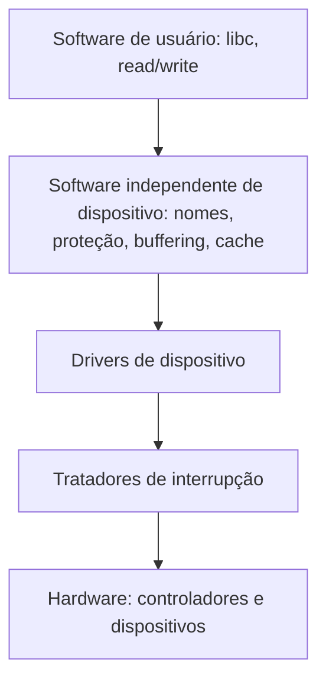
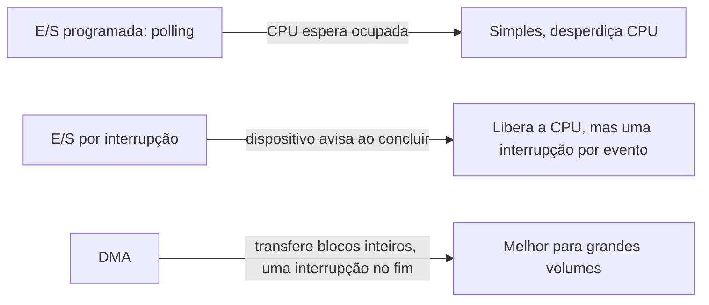

# Entrada e Saída (E-S)

## Resumo

O subsistema de E/S esconde a enorme variedade de dispositivos (teclado, disco, rede, GPU) atrás de interfaces uniformes. Seus objetivos: **independência de dispositivo**, **nomes uniformes**, **tratamento de erros**, **transferência síncrona ou assíncrona** e **buffering**.

## Pilha de E/S



## Como a CPU fala com o dispositivo

| Método | Descrição | Exemplo |
|---|---|---|
| **Portas de E/S** | Espaço de endereços separado, instruções `in`/`out` | x86 legado (teclado PS/2, UART) |
| **E/S mapeada em memória (MMIO)** | Registradores do dispositivo aparecem como endereços de memória | PCIe, GPUs, NVMe, quase tudo moderno |
| **DMA** | O dispositivo lê/escreve a RAM sozinho ([[DMA - Acesso Direto à Memória]]) | Disco, rede, áudio |

## Três técnicas de transferência



| Técnica | Vantagem | Desvantagem | Uso |
|---|---|---|---|
| **Polling** | Latência mínima, sem custo de interrupção | Gasta CPU | Dispositivos rápidos e previsíveis; NAPI, SPDK, DPDK |
| **Interrupções** | CPU livre para outro trabalho | Overhead por interrupção | Teclado, mouse, eventos esporádicos |
| **DMA** | Mínimo envolvimento da CPU | Complexidade (IOMMU, coerência de cache) | Disco, rede, vídeo |

> [!tip] Abordagem híbrida
> Para redes de 10-100 Gbps, o Linux usa **NAPI**: a primeira interrupção desliga novas e passa a fazer *polling* até esvaziar a fila; depois reativa as interrupções.

## E/S bloqueante x não bloqueante x assíncrona

| Modelo | Comportamento |
|---|---|
| **Bloqueante** | `read` dorme até ter dados |
| **Não bloqueante** | Retorna imediatamente (`EAGAIN`) se não há dados |
| **Multiplexada** | `select`/`poll`/`epoll` esperam vários descritores |
| **Assíncrona (AIO)** | Dispara a operação e é notificado ao fim: `io_uring`, IOCP (Windows), POSIX AIO |

```c
#include <fcntl.h>
#include <unistd.h>
#include <errno.h>
#include <stdio.h>

int main(void) {
    int fd = open("/dev/stdin", O_RDONLY | O_NONBLOCK);
    char b[64];
    ssize_t n = read(fd, b, sizeof b);
    if (n < 0 && errno == EAGAIN)
        puts("sem dados agora; posso fazer outra coisa");
    return 0;
}
```

```python
# E/S assíncrona com asyncio: milhares de conexões em uma thread
import asyncio

async def cliente(r, w):
    dados = await r.read(100)       # não bloqueia a thread
    w.write(dados); await w.drain(); w.close()

async def main():
    srv = await asyncio.start_server(cliente, "127.0.0.1", 9000)
    async with srv: await srv.serve_forever()

asyncio.run(main())
```

## Observando a E/S

```bash
iostat -xz 1                 # utilização e latência por dispositivo
sudo iotop -o                # processos que mais usam disco
cat /proc/interrupts | head  # interrupções por dispositivo
lspci -k                     # dispositivos PCI e drivers em uso
cat /proc/iomem | head       # mapa MMIO
cat /proc/ioports | head     # portas de E/S
```

## Tratamento de erros

O SO retorna códigos (`errno`: `EIO`, `ENOSPC`, `EINTR`), faz *retries*, marca dispositivos como falhos e registra no log do kernel (`dmesg`).

## Pontos-chave

- Três formas de transferência: polling, interrupção, DMA.
- MMIO é o padrão para acessar registradores de dispositivos.
- E/S assíncrona (`epoll`, `io_uring`) escala servidores.

## Veja também

[[Drivers de Dispositivo]] · [[DMA - Acesso Direto à Memória]] · [[Interrupções]] · [[MOC - Entrada e Saída]]
