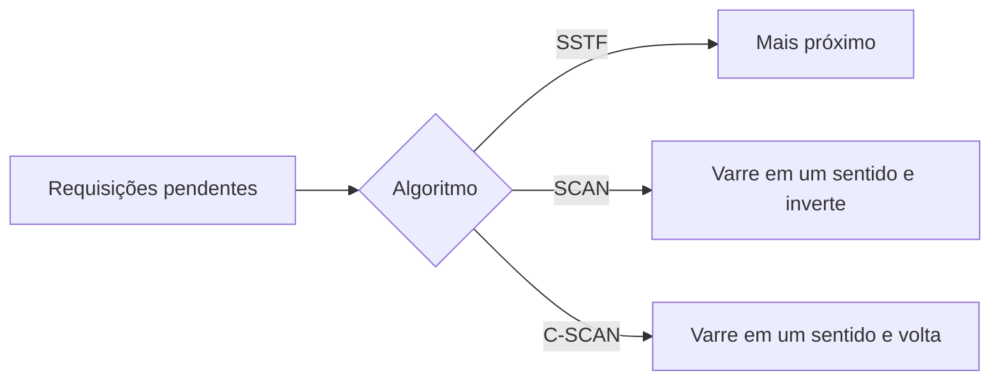

# Escalonadores de Disco

## Resumo

Em **HDDs**, o tempo de acesso é dominado pelo **seek** (mover o braço) e pela **latência rotacional**. O **escalonador de E/S** reordena as requisições pendentes para reduzir o movimento. Em **SSDs/NVMe**, não há partes móveis; a reordenação importa pouco, e o foco passa a ser justiça e baixa sobrecarga.

## Tempo de acesso em HDD

`tempo = seek + latência rotacional + transferência`

- Seek: 3-10 ms. Rotacional média em 7200 rpm: 60/7200/2 = **4,17 ms**. Transferência: bem menor.
- Acesso aleatório de 4 KiB: ~100-200 IOPS. Sequencial: 100-250 MB/s.

## Algoritmos clássicos

Cabeça em 53, cilindros 0-199, fila: `98, 183, 37, 122, 14, 124, 65, 67`.

| Algoritmo | Ideia | Movimento total (cilindros) | Observação |
|---|---|---|---|
| **FCFS** | Ordem de chegada | 640 | Justo, mas muito movimento |
| **SSTF** | Menor seek primeiro | 236 | Pode causar inanição (como SJF) |
| **SCAN (elevador)** | Vai até uma ponta atendendo, inverte | depende do sentido | Sem inanição |
| **C-SCAN** | Atende em um só sentido; volta sem atender | - | Tempo de espera mais uniforme |
| **LOOK / C-LOOK** | Como SCAN, mas inverte no último pedido | menor que SCAN | Usados na prática |

```python
def fcfs(inicio, fila):
    total, pos = 0, inicio
    for c in fila:
        total += abs(c - pos); pos = c
    return total

def sstf(inicio, fila):
    pend, pos, total = fila[:], inicio, 0
    while pend:
        prox = min(pend, key=lambda c: abs(c - pos))
        total += abs(prox - pos); pos = prox; pend.remove(prox)
    return total

fila = [98, 183, 37, 122, 14, 124, 65, 67]
print(fcfs(53, fila), sstf(53, fila))   # 640 236
```



## Escalonadores no Linux (blk-mq)

| Escalonador | Descrição | Uso |
|---|---|---|
| `none` | Sem reordenação (FIFO por fila de hardware) | NVMe, SSDs rápidos, virtualização |
| `mq-deadline` | Agrupa e ordena por setor, com **prazo** para leituras (500 ms) e escritas (5 s) | HDD e SSDs SATA; bom padrão |
| `bfq` | **Budget Fair Queueing**: justiça por processo, baixa latência interativa | Desktops com HDD, cargas mistas |
| `kyber` | Controla latência por filas de leitura/escrita | Dispositivos rápidos |

```bash
cat /sys/block/sda/queue/scheduler          # [mq-deadline] none bfq (o entre colchetes está ativo)
echo bfq | sudo tee /sys/block/sda/queue/scheduler
cat /sys/block/nvme0n1/queue/rotational     # 0 = SSD, 1 = HDD
cat /sys/block/sda/queue/nr_requests        # profundidade da fila
# Regra udev para escolher automaticamente
# ACTION=="add|change", KERNEL=="sd[a-z]", ATTR{queue/rotational}=="1", ATTR{queue/scheduler}="bfq"
```

Medição:

```bash
iostat -x 1                          # await (latência), %util, aqu-sz (fila)
sudo fio --name=aleatorio --rw=randread --bs=4k --iodepth=32 --size=1G --runtime=30 --filename=/dev/sdX --direct=1
```

Saída comentada (`iostat -x`):

```text
Device   r/s   w/s  r_await w_await aqu-sz %util
sda     85.0  40.0    11.2    28.4   3.10  97.0   # %util ~100% e await alto: disco saturado
```

## HDD x SSD

| Aspecto | HDD | SSD/NVMe |
|---|---|---|
| Latência | ms | 20-100 µs |
| Aleatório x sequencial | Enorme diferença | Pequena |
| Reordenação | Muito valiosa | Quase irrelevante |
| Paralelismo | 1 cabeça | Muitos canais e filas (NVMe: até 64K filas) |
| Desgaste | Mecânico | Ciclos de escrita limitados (use TRIM, evite escrita desnecessária) |
| Escalonador ideal | `mq-deadline` / `bfq` | `none` |

> [!tip] `fstrim`
> Em SSDs, habilite `fstrim.timer` (semanal) para informar blocos livres ao dispositivo e manter o desempenho de escrita.

## Pontos-chave

- Em HDD, reduza o movimento da cabeça: SCAN/LOOK, SSTF com cuidado.
- Linux usa `mq-deadline`, `bfq`, `kyber` ou `none` com blk-mq.
- Para NVMe, `none` costuma ser o melhor.

## Veja também

[[Dispositivos de Bloco e de Caractere]] · [[Escalonamento de Processos]] · [[MOC - Entrada e Saída]]
