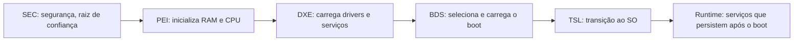

# BIOS e UEFI

## Resumo

O **firmware** é o primeiro software executado ao ligar. **BIOS** (*Basic Input/Output System*, 1975-) foi o padrão por décadas; o **UEFI** (*Unified Extensible Firmware Interface*) o substituiu, com mais recursos, suporte a discos grandes e **Secure Boot**.

## Comparação

| Aspecto | BIOS (legado) | UEFI |
|---|---|---|
| Modo de execução | 16 bits real mode | 32/64 bits |
| Particionamento | **MBR** (até 2 TiB, 4 partições primárias) | **GPT** (até 9,4 ZB, 128 partições por padrão) |
| Onde fica o bootloader | Primeiros 440 bytes do setor 0 (MBR) | Arquivo `.efi` na **ESP** (EFI System Partition, FAT32) |
| Configuração de boot | Ordem de dispositivos | **Variáveis NVRAM** (`Boot0001`, `BootOrder`) com entradas nomeadas |
| Interface | Texto, teclado | GUI, mouse, rede |
| Segurança | Nenhuma | **Secure Boot**, medição por TPM |
| Drivers | Option ROMs | Drivers UEFI (`.efi`) e serviços de boot |
| Boot por rede | PXE | PXE e HTTP Boot |
| Velocidade | Mais lenta | Mais rápida |

## Sequência do firmware UEFI



- **Boot Services** (disponíveis até `ExitBootServices`) e **Runtime Services** (variáveis NVRAM, hora, reset).
- **POST** testa componentes; códigos de bipes ou LEDs indicam falhas.

## MBR x GPT

```text
MBR (512 bytes, setor 0):
  [0-439]   código do bootloader (stage 1)
  [440-445] assinatura do disco
  [446-509] 4 entradas de partição de 16 bytes
  [510-511] assinatura 0x55AA
```

GPT: cabeçalho primário no LBA 1, tabela de partições, **cópia de backup no fim do disco** e **MBR protetor** no setor 0 para compatibilidade. Cada partição tem **GUID** e CRC32.

```bash
sudo fdisk -l /dev/sda                    # mostra "Disklabel type: gpt" ou "dos"
sudo gdisk -l /dev/sda
lsblk -o NAME,PTTYPE,PARTTYPENAME,FSTYPE,MOUNTPOINT
ls /sys/firmware/efi                      # existe => bootou por UEFI
sudo efibootmgr -v                        # entradas de boot UEFI (NVRAM)
sudo efibootmgr -o 0001,0000              # altera a ordem
mount | grep -i efi                       # ESP montada em /boot/efi ou /efi
```

Saída comentada (`efibootmgr`):

```text
BootCurrent: 0001
BootOrder: 0001,0000
Boot0000* Windows Boot Manager  HD(1,GPT,...)/File(\EFI\Microsoft\Boot\bootmgfw.efi)
Boot0001* ubuntu                HD(1,GPT,...)/File(\EFI\ubuntu\shimx64.efi)   # entrada ativa
```

Estrutura típica da ESP:

```text
/boot/efi/EFI/
├── BOOT/BOOTX64.EFI        # caminho de fallback padrão
├── ubuntu/shimx64.efi, grubx64.efi
└── Microsoft/Boot/bootmgfw.efi
```

## Secure Boot

O firmware só executa binários **assinados** por chaves confiáveis:

| Base | Papel |
|---|---|
| **PK** (Platform Key) | Chave do dono da plataforma |
| **KEK** | Chaves que autorizam atualizar db/dbx |
| **db** | Assinaturas e certificados permitidos |
| **dbx** | Revogações (binários proibidos) |

Distribuições Linux usam o **shim** (assinado pela Microsoft) que verifica o GRUB e o kernel com a chave da distribuição (MOK). Módulos de kernel de terceiros precisam ser assinados.

```bash
mokutil --sb-state                        # SecureBoot enabled/disabled
sudo mokutil --import chave.der           # registra chave própria (MOK)
```

```powershell
Confirm-SecureBootUEFI                    # True se ativo
Get-Tpm
```

## Atualização do firmware

Via **fwupd/LVFS** no Linux, utilitários do fabricante ou Windows Update.

```bash
fwupdmgr get-devices && fwupdmgr refresh && fwupdmgr get-updates
```

## Vantagens e desvantagens

| | Vantagens | Desvantagens |
|---|---|---|
| **BIOS** | Simples; compatibilidade universal com sistemas antigos | Limite de 2 TiB (MBR); sem segurança; lenta |
| **UEFI** | Rápida, GPT, Secure Boot, interface e rede, extensível | Mais complexa; maior superfície de ataque do firmware; Secure Boot pode atrapalhar sistemas não assinados |

> [!warning] Firmware é alvo de ataque
> *Bootkits* e implantes de firmware persistem após reinstalar o SO. Mantenha o firmware atualizado, use Secure Boot e senha de administrador na configuração.

## Pontos-chave

- UEFI + GPT + ESP é o padrão atual; BIOS + MBR é legado.
- Secure Boot verifica a cadeia de assinaturas.
- `efibootmgr` e `/sys/firmware/efi` informam o modo de boot.

## Veja também

[[Processo de Boot]] · [[Bootloader]] · [[MOC - Boot]]
