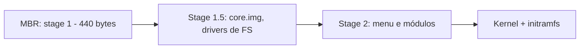
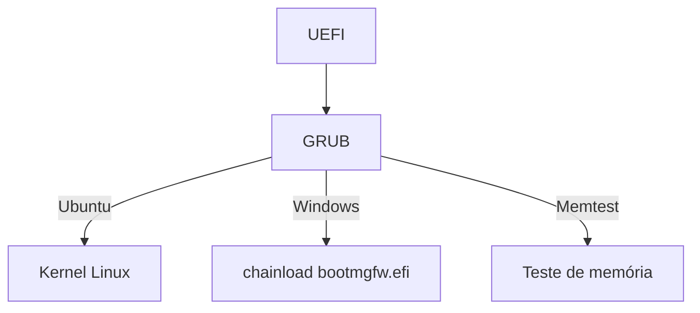

# Bootloader

## Resumo

O **bootloader** é o programa que o firmware executa para **carregar o kernel** (e o initramfs) na memória, passando-lhe **parâmetros** e o controle. Também oferece **menu** para escolher entre sistemas ou kernels (*multi-boot*) e modos de recuperação.

## Responsabilidades

1. Ler a configuração (entradas de menu).
2. Entender sistemas de arquivos para encontrar o kernel (ext4, FAT, Btrfs...).
3. Carregar **kernel**, **initramfs** e, em ARM, o **device tree**.
4. Montar a **linha de comando** do kernel (`root=`, `quiet`, `ro`...).
5. Saltar para o ponto de entrada do kernel.
6. (Opcional) Verificar assinaturas (Secure Boot).

## Estágios no BIOS/MBR



Como o MBR é minúsculo, o carregamento é feito em estágios. Em **UEFI**, o bootloader é um único aplicativo `.efi` na ESP que usa serviços do firmware (sem estágios).

## Principais bootloaders

| Bootloader | Plataforma | Observações |
|---|---|---|
| **GRUB 2** | Linux (BIOS e UEFI) | Poderoso e scriptável; menu, suporte a muitos FS, LUKS, encadeia outros |
| **systemd-boot** | Linux UEFI | Simples; entradas em arquivos, integra com `bootctl` e UKI |
| **rEFInd** | UEFI | Gerenciador gráfico, detecção automática |
| **Syslinux / ISOLINUX** | Mídias de instalação | Leve |
| **Windows Boot Manager** (`bootmgr`/`bootmgfw.efi`) + `winload` | Windows | Configuração no **BCD** |
| **iBoot** / **m1n1** | Apple Silicon | Cadeia fechada; Asahi Linux usa m1n1 + U-Boot |
| **U-Boot** | Embarcados ARM/RISC-V | Rede (TFTP), scripts, múltiplos dispositivos |
| **Coreboot + payload** | Firmware aberto | Substitui o firmware |
| **Limine**, **Das U-Boot SPL** | Outros | - |

## GRUB na prática

```bash
# Instalação
sudo grub-install --target=x86_64-efi --efi-directory=/boot/efi --bootloader-id=ubuntu   # UEFI
sudo grub-install /dev/sda                                                                  # BIOS
sudo update-grub                          # Debian/Ubuntu: gera /boot/grub/grub.cfg
sudo grub2-mkconfig -o /boot/grub2/grub.cfg   # Fedora/RHEL

# Configuração em /etc/default/grub
#   GRUB_TIMEOUT=5
#   GRUB_CMDLINE_LINUX_DEFAULT="quiet splash"
#   GRUB_DISABLE_OS_PROBER=false          # detectar Windows
```

Entrada de menu (trecho de `grub.cfg`):

```text
menuentry 'Ubuntu' {
    search --no-floppy --fs-uuid --set=root 3f9c1e2a-...     # acha a partição pelo UUID
    linux  /vmlinuz-6.8.0 root=UUID=3f9c1e2a-... ro quiet    # kernel + parâmetros
    initrd /initrd.img-6.8.0                                  # initramfs
}
```

No prompt do GRUB (recuperação):

```text
grub> ls
grub> set root=(hd0,gpt2)
grub> linux /vmlinuz root=/dev/sda2
grub> initrd /initrd.img
grub> boot
```

Parâmetros úteis do kernel (editar com `e` no menu): `single`/`systemd.unit=rescue.target` (recuperação), `init=/bin/bash` (emergência), `nomodeset` (problemas de vídeo), `ro`/`rw`, `quiet`, `console=ttyS0`.

## systemd-boot

```bash
sudo bootctl install                       # instala na ESP
bootctl status
# Entrada: /boot/loader/entries/arch.conf
#   title   Arch Linux
#   linux   /vmlinuz-linux
#   initrd  /initramfs-linux.img
#   options root=UUID=... rw quiet
```

**Unified Kernel Image (UKI)**: kernel + initramfs + cmdline em **um único `.efi` assinado**, simplificando o Secure Boot.

## Windows (BCD)

```powershell
bcdedit /enum                               # lista o BCD
bcdedit /set {default} bootmenupolicy legacy
bcdedit /timeout 10
bootrec /fixmbr; bootrec /rebuildbcd        # reparo a partir do ambiente de recuperação
```

## Multi-boot e dual boot



> [!tip] Dual boot com Windows
> Instale o Windows **primeiro**; ele pode sobrescrever o bootloader. Desative a "inicialização rápida" e a hibernação do Windows para montar a partição NTFS com segurança no Linux.

## Segurança

- **Senha no GRUB** impede edição de parâmetros (`grub-mkpasswd-pbkdf2`).
- **Secure Boot** com shim e assinaturas.
- **Criptografia de disco** (LUKS): o initramfs pede a senha; `/boot` pode ficar cifrado no GRUB ou separado e verificado.
- Evite `init=/bin/bash` sem proteção física/firmware.

## Vantagens e desvantagens

| Bootloader | Vantagens | Desvantagens |
|---|---|---|
| GRUB | Muito flexível, universal | Complexo; `grub.cfg` gerado por scripts |
| systemd-boot | Simples, rápido, integra UKI | Só UEFI; menos recursos |
| U-Boot | Padrão embarcado; rede e scripts | Configuração específica por placa |
| bootmgr | Integrado ao Windows | Só para o ecossistema Windows; BCD pouco amigável |

## Pontos-chave

- Bootloader carrega kernel + initramfs e passa parâmetros.
- GRUB (flexível) x systemd-boot (simples) x U-Boot (embarcados).
- UKI e Secure Boot fortalecem a cadeia de confiança.

## Veja também

[[Processo de Boot]] · [[BIOS e UEFI]] · [[Init e systemd]] · [[MOC - Boot]]
