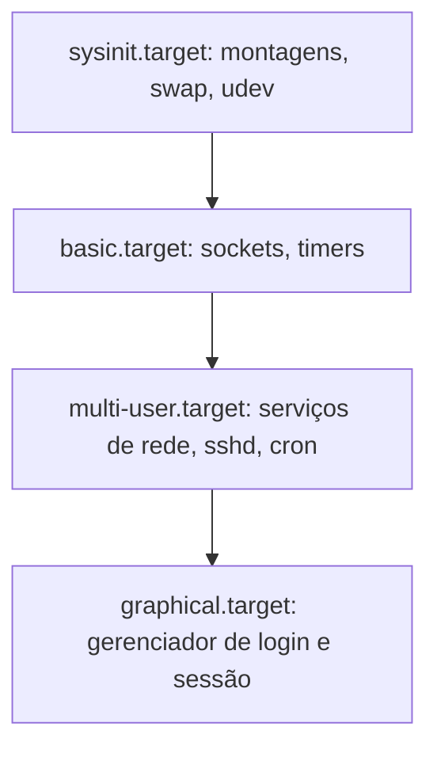

# Init e systemd

## Resumo

Depois de montar a raiz, o kernel executa **um único programa em user space: o PID 1 (init)**. Ele inicia todos os serviços, adota processos órfãos e coleta zumbis. Se o PID 1 morrer, o kernel entra em *panic*.

## Famílias de init

| Sistema | Modelo | Onde |
|---|---|---|
| **SysV init** | Scripts sequenciais em runlevels (`/etc/rc*.d`) | UNIX clássico, Linux antigo |
| **Upstart** | Orientado a eventos | Ubuntu antigo |
| **systemd** | Unidades, dependências, ativação paralela, cgroups | Maioria das distribuições Linux |
| **OpenRC, runit, s6** | Mais simples e minimalistas | Alpine, Gentoo, Void |
| **launchd** | Daemons e agentes sob demanda | macOS ([[launchd]]) |
| **Windows**: `smss.exe` → `wininit.exe` → **SCM** (`services.exe`) | Serviços do Windows | Windows NT |
| **init do Android** | Arquivos `.rc` | Android |

## systemd: conceitos

| Conceito | Descrição |
|---|---|
| **Unit** (unidade) | Objeto gerenciado: `.service`, `.socket`, `.timer`, `.mount`, `.target`, `.path`, `.device`, `.slice` |
| **Target** | Grupo de unidades (equivale a runlevel): `multi-user.target`, `graphical.target`, `rescue.target` |
| **Dependências** | `Requires=`, `Wants=`, `After=`, `Before=`, `Conflicts=` |
| **Ativação** | Por socket, timer, dispositivo, D-Bus, caminho |
| **cgroups** | Cada serviço roda em seu cgroup: contabilidade e limites ([[cgroups - SO]]) |
| **journald** | Log estruturado e binário ([[journalctl]]) |



## Unidade de serviço

```ini
# /etc/systemd/system/meuapp.service
[Unit]
Description=Meu aplicativo
After=network-online.target postgresql.service
Wants=network-online.target

[Service]
Type=simple
User=meuapp
WorkingDirectory=/opt/meuapp
ExecStart=/opt/meuapp/bin/servidor --porta 8080
Restart=on-failure
RestartSec=5
# Hardening
NoNewPrivileges=true
ProtectSystem=strict
ProtectHome=true
PrivateTmp=true
ReadWritePaths=/var/lib/meuapp
# Limites (cgroup)
MemoryMax=512M
CPUQuota=50%

[Install]
WantedBy=multi-user.target
```

```bash
sudo systemctl daemon-reload                 # relê unidades
sudo systemctl enable --now meuapp           # habilita no boot e inicia
systemctl status meuapp                      # estado, PID, últimos logs
journalctl -u meuapp -f                      # acompanha logs
sudo systemctl restart meuapp
systemd-analyze security meuapp              # nota de exposição do serviço
```

Timer como alternativa ao cron:

```ini
# /etc/systemd/system/backup.timer
[Timer]
OnCalendar=*-*-* 02:00:00
Persistent=true
[Install]
WantedBy=timers.target
```

```bash
sudo systemctl enable --now backup.timer
systemctl list-timers
```

## Targets e recuperação

```bash
systemctl get-default                        # alvo padrão
sudo systemctl set-default multi-user.target # inicia sem interface gráfica
sudo systemctl isolate rescue.target         # modo de recuperação
systemctl list-dependencies graphical.target
```

## Diagnóstico

```bash
systemctl --failed                           # unidades que falharam
systemd-analyze blame | head
systemd-analyze critical-chain
ps -p 1 -o pid,comm                          # confirma systemd como PID 1
pstree -p | head -5
```

## Críticas e alternativas

> [!info] Debate
> O systemd é criticado por **escopo amplo** (init + logs + rede + login + DNS...), formato de log binário e acoplamento. Seus defensores apontam inicialização paralela, dependências declarativas, isolamento por cgroups e gestão de serviços uniforme. Alternativas leves existem (OpenRC, runit, s6) e são comuns em contêineres e distribuições minimalistas.

## Init em contêineres

Em Docker, o processo principal é PID 1 do namespace de PIDs e **não** trata sinais/zumbis automaticamente; use `--init` (tini) ou um supervisor.

```bash
docker run --init meu-imagem
```

## Vantagens e desvantagens do systemd

| Vantagens | Desvantagens |
|---|---|
| Boot rápido por paralelismo | Complexidade e grande base de código |
| Dependências declarativas e ativação sob demanda | Menos aderente à filosofia UNIX "uma ferramenta, uma tarefa" |
| Gestão por cgroups e hardening integrados | Logs binários exigem `journalctl` |
| Interface uniforme (`systemctl`) | Diferenças entre versões e distribuições |

## Pontos-chave

- PID 1 inicia e supervisiona todo o user space.
- systemd = unidades + dependências + cgroups + journal.
- Use `systemctl` e `journalctl` para operar e diagnosticar.

## Veja também

[[Processo de Boot]] · [[Bootloader]] · [[MOC - Boot]]
