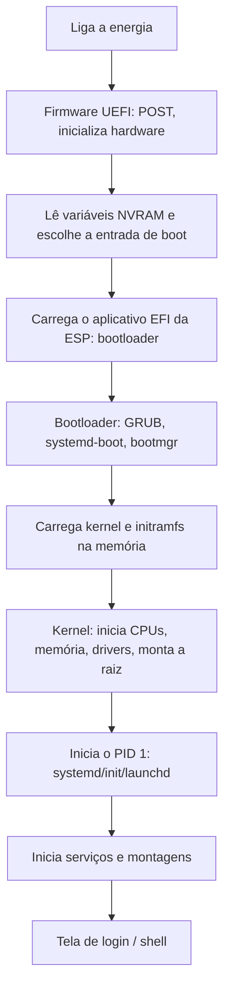

# Processo de Boot

## Resumo

O **boot** (inicialização) leva a máquina de **desligada** ao **sistema pronto**. Cada estágio é pequeno e carrega o próximo, ampliando a capacidade (*bootstrapping*): firmware → bootloader → kernel → init → serviços → login.

## Fluxo geral (PC moderno com UEFI)



## Etapas em detalhe

| Etapa | O que acontece |
|---|---|
| **Firmware** | Reset da CPU executa código na ROM/flash; **POST** testa e inicializa RAM, barramentos, dispositivos |
| **Seleção do dispositivo** | UEFI lê a ordem de boot; BIOS procura o setor de boot (MBR) |
| **Bootloader** | Apresenta menu, carrega kernel e **initramfs**, passa **parâmetros** (linha de comando do kernel) |
| **Kernel (early boot)** | Descompacta-se, configura MMU, memória, escalonador, interrupções, descobre dispositivos |
| **initramfs** | Mini sistema na RAM com drivers e scripts para achar e montar a raiz real (LVM, LUKS, RAID, rede) |
| **Montagem da raiz** | `switch_root` para o sistema de arquivos real |
| **Init (PID 1)** | Lança serviços em paralelo; chega ao alvo (multi-user ou graphical) |
| **Login** | `getty`, gerenciador de exibição (GDM, SDDM), `login` |

## Cadeia de confiança (boot seguro)


Cada estágio **mede e verifica** o próximo; com **TPM**, as medições (PCRs) permitem atestação e desbloqueio de disco criptografado (BitLocker, `systemd-cryptenroll`).

## Boot em outros ambientes

| Plataforma | Cadeia |
|---|---|
| **Windows** | UEFI → `bootmgfw.efi` (Boot Manager) → `winload.efi` → `ntoskrnl.exe` → `smss.exe` → `wininit`/`services` |
| **macOS** (Apple Silicon) | Boot ROM → iBoot → kernel XNU → `launchd` |
| **Android** | Boot ROM → bootloader → kernel Linux → `init` → Zygote → apps |
| **Embarcado** | ROM → SPL/U-Boot → kernel + device tree → init/BusyBox |
| **Nuvem** | Firmware virtual (OVMF/SeaBIOS) → bootloader → `cloud-init` |

## Observando o boot

```bash
dmesg | head -50                        # mensagens do kernel desde o início
journalctl -b                           # log do boot atual
journalctl -b -1                        # boot anterior
systemd-analyze                         # tempo total: firmware, loader, kernel, userspace
systemd-analyze blame | head            # serviços mais lentos
systemd-analyze critical-chain          # cadeia crítica
cat /proc/cmdline                       # parâmetros passados ao kernel
ls /sys/firmware/efi 2>/dev/null && echo "UEFI" || echo "BIOS legado"
```

Saída comentada (`systemd-analyze`):

```text
Startup finished in 4.2s (firmware) + 2.1s (loader) + 1.8s (kernel) + 7.4s (userspace) = 15.5s
graphical.target reached after 7.1s in userspace      # alvo gráfico atingido
```

```powershell
# Windows
bcdedit /enum                           # entradas do Boot Manager
msinfo32                                # modo da BIOS (UEFI/Legado), Secure Boot
Get-WinEvent -FilterHashtable @{LogName='System'; Id=6005,6006} | Select -First 4   # início/parada do log
```

## Problemas comuns

| Sintoma | Causa provável | Ação |
|---|---|---|
| "No bootable device" | Ordem de boot/ESP ausente | Ajustar firmware; reinstalar bootloader |
| `grub>` prompt | Configuração perdida | `grub-install`, `update-grub` |
| `Kernel panic - not syncing: VFS: Unable to mount root fs` | Raiz errada, initramfs sem driver | Regenerar initramfs; verificar `root=` |
| Boot lento | Serviço travado, timeout de rede/montagem | `systemd-analyze blame` |
| Secure Boot violation | Módulo/kernel não assinado | Assinar ou desativar com ciência do risco |

```bash
# Regenerar initramfs
sudo update-initramfs -u -k all         # Debian/Ubuntu
sudo dracut --force                     # Fedora/RHEL
```

## Pontos-chave

- Cadeia: firmware → bootloader → kernel (+ initramfs) → init → serviços.
- Secure Boot e TPM criam cadeia de confiança.
- `dmesg`, `journalctl -b` e `systemd-analyze` diagnosticam o boot.

## Veja também

[[BIOS e UEFI]] · [[Bootloader]] · [[Init e systemd]] · [[MOC - Boot]]
