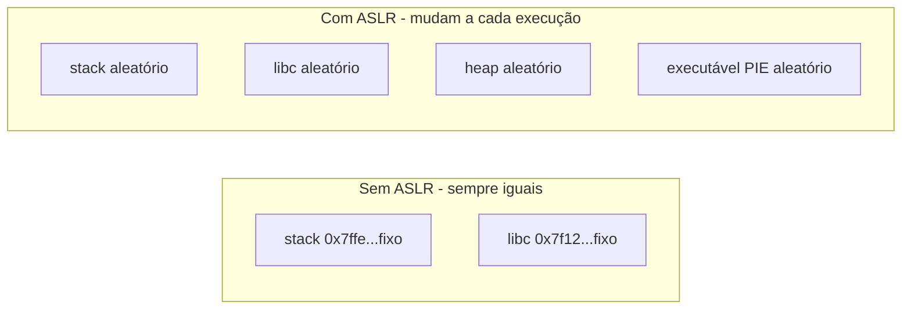

# ASLR - Address Space Layout Randomization

## Resumo

O **ASLR** **aleatoriza os endereços** de base da pilha, heap, bibliotecas e (com PIE) do executável a cada execução. Ataques de corrupção de memória precisam de endereços previsíveis (de código, gadgets ROP, `libc`); com ASLR, o atacante precisa antes **vazar** um endereço ou adivinhar.

## Efeito prático



```bash
# Execute duas vezes: os endereços de bibliotecas mudam
for i in 1 2 3; do grep -m1 libc /proc/self/maps; done
cat /proc/sys/kernel/randomize_va_space      # 0 off, 1 pilha/mmap/vdso, 2 também heap (padrão)
```

```c
// aslr.c - compile: gcc -fPIE -pie aslr.c -o aslr
#include <stdio.h>
#include <stdlib.h>
int g;
int main(void) {
    int local;
    void *heap = malloc(8);
    printf("main=%p global=%p heap=%p stack=%p printf=%p\n",
           (void*)main, (void*)&g, heap, (void*)&local, (void*)printf);
    return 0;
}
```

Cada execução imprime valores diferentes.

## O que é aleatorizado

| Região | Observação |
|---|---|
| Pilha | Base aleatória, deslocamento extra |
| Heap | `brk` com deslocamento aleatório |
| `mmap` e bibliotecas | Base aleatória por execução |
| Executável | **Somente se compilado como PIE** (Position Independent Executable) |
| vDSO, kernel (KASLR) | Kernel também randomiza (KASLR) |

Entropia: x86-64 Linux usa cerca de 28-30 bits para `mmap`; **32 bits** tem pouca entropia (8-16 bits) e é mais fácil de forçar.

## Windows e macOS

- **Windows**: ASLR desde o Vista; requer `/DYNAMICBASE`; **High Entropy ASLR** em 64 bits; *Mandatory ASLR* via Exploit Protection.
- **macOS/iOS**: ASLR para bibliotecas, **PIE** obrigatório; **KASLR**.

```powershell
Get-ProcessMitigation -System               # mostra ASLR e DEP
Get-ProcessMitigation -Name chrome.exe
```

## Limitações e bypass

> [!warning] ASLR não é bala de prata
> - **Vazamento de informação** (ex.: *format string*, leitura fora dos limites) revela um endereço e permite calcular os demais.
> - **Força bruta** em serviços que reiniciam o mesmo processo com layout igual (`fork` sem `exec`).
> - **Heap spraying** e *partial overwrite*.
> - **Ataques por canal lateral** (cache/TLB) podem inferir endereços (inclusive de KASLR).
> - Regiões não randomizadas (executável não-PIE) dão gadgets fixos.

## Boas práticas

```bash
gcc -fPIE -pie -fstack-protector-strong -D_FORTIFY_SOURCE=2 -Wl,-z,relro,-z,now prog.c -o prog
checksec --file=./prog                       # verifica PIE, RELRO, canário, NX
readelf -h ./prog | grep Type                # DYN = PIE; EXEC = não PIE
```

Combine ASLR com [[DEP, NX e Mitigações de Exploração]], canários de pilha, RELRO total, CFI e [[Sandboxing]].

## Pontos-chave

- ASLR dificulta prever endereços; exige PIE para o executável.
- Vazamentos de informação o contornam.
- É uma camada; funciona melhor combinado com NX, canários e CFI.

## Veja também

[[DEP, NX e Mitigações de Exploração]] · [[Memória Virtual]] · [[MOC - Segurança - SO]]
