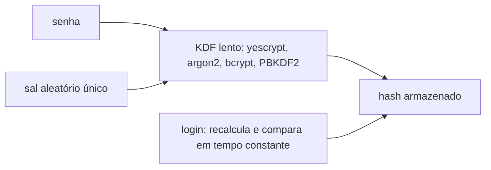
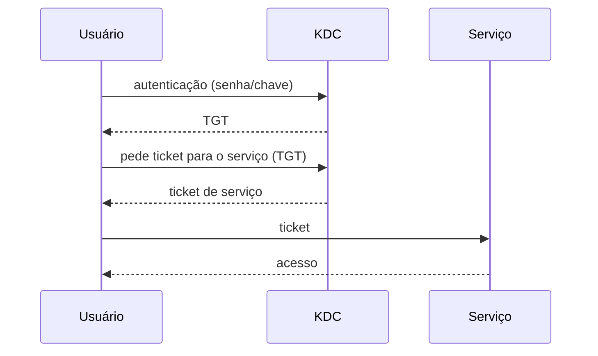

# Autenticação

## Resumo

**Autenticação** é comprovar a identidade de um usuário ou serviço (*quem é você?*). Depois dela vêm a **autorização** (*o que pode fazer?*, ver [[Controle de Acesso]]) e a **auditoria** (*o que fez?*).

## Fatores

| Fator | Exemplos |
|---|---|
| Algo que você **sabe** | Senha, PIN |
| Algo que você **tem** | Token FIDO2/YubiKey, smartcard, TOTP no celular |
| Algo que você **é** | Biometria (digital, rosto) |
| Onde / quando | Localização, horário (contexto) |

**MFA** combina fatores de categorias diferentes. Chaves FIDO2/passkeys resistem a *phishing*.

## Armazenamento seguro de senhas

O SO nunca guarda a senha, e sim um **hash lento com sal**.



| Propriedade | Motivo |
|---|---|
| **Sal** | Impede tabelas arco-íris e hashes iguais para senhas iguais |
| **Lento e com uso de memória** | Torna ataques de força bruta caros (GPU/ASIC) |
| **Comparação em tempo constante** | Evita ataques por tempo |

```bash
# Linux: /etc/shadow (apenas root lê)
sudo grep "^$USER:" /etc/shadow
# usuario:$y$j9T$sal...$hash...:19700:0:99999:7:::
#          └ $y$ = yescrypt; $6$ = SHA-512 crypt; $2b$ = bcrypt
openssl passwd -6 -salt abc senha123         # gera hash SHA-512crypt (demonstração)
chage -l $USER                               # política de expiração
```

```python
# Boas práticas em aplicações: argon2
from argon2 import PasswordHasher
ph = PasswordHasher()
h = ph.hash("minha-senha")
ph.verify(h, "minha-senha")      # lança exceção se errada
```

| SO | Base de credenciais |
|---|---|
| Linux | `/etc/passwd` (contas), `/etc/shadow` (hashes), PAM |
| Windows | **SAM** local (hash NT), **Active Directory** (Kerberos, NTLM), **LSASS** |
| macOS | Directory Services, Keychain, Secure Enclave |

## PAM (Linux)

Os **Pluggable Authentication Modules** separam aplicações (login, sudo, ssh) dos métodos de autenticação, configurados em `/etc/pam.d/`.

```text
# /etc/pam.d/sshd (trecho)
auth     required   pam_faildelay.so delay=2000000
auth     required   pam_google_authenticator.so     # exige TOTP
account  required   pam_nologin.so
session  required   pam_limits.so
```

Pilhas: `auth`, `account`, `password`, `session`. Controles: `required`, `requisite`, `sufficient`, `optional`.

## Kerberos e SSO

Em ambientes corporativos (AD): o usuário se autentica **uma vez** no KDC e recebe um **TGT**; depois obtém **tickets de serviço** sem reenviar a senha, com tempo limitado.



## Ataques e defesas

| Ataque | Defesa |
|---|---|
| Força bruta / *credential stuffing* | KDF lento, bloqueio, MFA, `fail2ban` |
| Phishing | FIDO2/passkeys |
| Roubo de hashes (ex.: *pass-the-hash*, LSASS dump) | Credential Guard, LAPS, privilégio mínimo |
| Escalonamento via `sudo` mal configurado | Revisar `sudoers`, `NOPASSWD` mínimo |
| Chave SSH roubada | Proteger com passphrase, `ssh-agent`, certificados de curta duração |

```bash
sudo visudo                                  # edita sudoers com validação
sudo -l                                      # o que posso executar
ssh-keygen -t ed25519 -C "usuario@host"      # chave moderna
last -n 10; lastb | head                     # logins e falhas
```

```powershell
whoami /all                                  # SID, grupos e privilégios
net user; Get-LocalUser
klist                                        # tickets Kerberos
```

> [!warning] Nunca armazene senhas em texto ou com hash rápido (MD5/SHA-1/SHA-256 puro)
> Use KDF dedicado com sal e, em serviços críticos, MFA.

## Pontos-chave

- Autenticar é provar identidade; MFA combina fatores.
- Senhas: KDF lento + sal; compare em tempo constante.
- PAM (Linux) e Kerberos/AD (Windows) modularizam o processo.

## Veja também

[[Controle de Acesso]] · [[MOC - Segurança - SO]]
