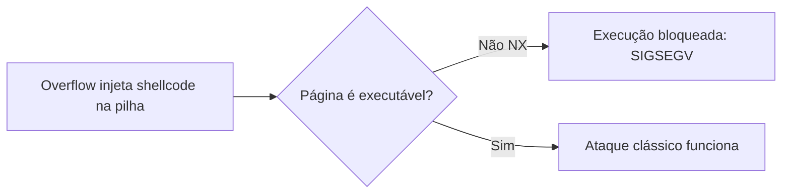

# DEP, NX e Mitigações de Exploração

## Resumo

**DEP** (*Data Execution Prevention*, Windows) / **NX** (*No-eXecute*, bit de hardware) / **W^X** (BSD, macOS): páginas de **dados** (pilha, heap) são marcadas como **não executáveis**; páginas de código, como **não graváveis**. Assim, um *buffer overflow* que injeta código na pilha **não consegue executá-lo**.

## Como funciona

O bit **NX** (XD na Intel) fica na entrada da tabela de páginas ([[Paginação]]). Ao buscar uma instrução em página NX, a CPU gera um *page fault* e o processo é encerrado.



Política **W^X**: nenhuma página é ao mesmo tempo gravável e executável. Compiladores JIT precisam alternar permissões (`mprotect`).

```bash
readelf -lW ./prog | grep GNU_STACK          # RW = pilha não executável; RWE = executável (perigoso)
cat /proc/self/maps | grep -E "rwx"          # regiões graváveis e executáveis (deveria ser raro)
```

```c
// Tenta executar código na pilha: falha com NX
#include <string.h>
int main(void) {
    unsigned char code[] = { 0xC3 };         // ret
    ((void(*)())code)();                     // Segmentation fault
    return 0;
}
```

## Contornos e novas defesas

| Técnica de ataque | Descrição | Defesa |
|---|---|---|
| **Return-to-libc** | Salta para funções existentes (`system`) | ASLR |
| **ROP** (*Return-Oriented Programming*) | Encadeia trechos de código existentes (*gadgets*) terminados em `ret` | ASLR, CFI, **CET (shadow stack)** |
| **JOP/COP** | Variações com saltos/chamadas indiretas | CFI, IBT |
| **Corrupção de ponteiros de função/vtable** | Redireciona chamadas | CFI, RELRO, vtable verification |
| **Data-only attacks** | Altera dados sem mexer no fluxo | Sandbox, MTE, linguagens seguras |

## Mitigações complementares

| Mitigação | O que faz |
|---|---|
| **Canário de pilha** (`-fstack-protector-strong`) | Valor aleatório antes do endereço de retorno; verificado ao sair da função |
| **ASLR / PIE** | Aleatoriza endereços ([[ASLR - Address Space Layout Randomization]]) |
| **RELRO total** (`-Wl,-z,relro,-z,now`) | GOT somente leitura após o carregamento |
| **FORTIFY_SOURCE** | Verifica limites em `memcpy`, `strcpy`... |
| **CFI** (Control-Flow Integrity) | Só permite saltos para alvos válidos (`-fsanitize=cfi`, Windows CFG/XFG) |
| **Intel CET** (shadow stack + IBT), **ARM PAC/BTI** | Hardware protege endereços de retorno e saltos indiretos |
| **ARM MTE** | Marcas de memória detectam *use-after-free* e overflows |
| **Zeroing/`init_on_alloc`** | Inicializa memória alocada |
| **Linguagens seguras** (Rust, Go, Swift) | Eliminam classes de erros de memória |

```bash
# Verificar mitigações de um binário
checksec --file=/bin/ls
# Compilar com o conjunto recomendado
gcc -O2 -fstack-protector-strong -D_FORTIFY_SOURCE=2 -fPIE -pie -Wl,-z,relro,-z,now -fcf-protection=full prog.c -o prog
# Mitigações do CPU contra Spectre/Meltdown
grep . /sys/devices/system/cpu/vulnerabilities/*
```

```c
// Canário de pilha em ação: compile com -fstack-protector e provoque overflow
#include <string.h>
void f(const char *s) { char buf[8]; strcpy(buf, s); }   // sem verificar tamanho
int main(void) { f("AAAAAAAAAAAAAAAAAAAA"); return 0; }  // *** stack smashing detected ***: terminated
```

## No Windows

```powershell
Get-ProcessMitigation -System
bcdedit /enum | findstr nx                   # política DEP do sistema (OptIn/OptOut/AlwaysOn)
Set-ProcessMitigation -Name app.exe -Enable DEP,CFG,ForceRelocateImages
```

## Pontos-chave

- NX/DEP/W^X impedem executar dados; atacantes passam a reutilizar código (ROP).
- ASLR + canários + CFI + CET formam defesa em camadas.
- Linguagens com segurança de memória removem a causa raiz.

## Veja também

[[ASLR - Address Space Layout Randomization]] · [[Sandboxing]] · [[MOC - Segurança - SO]]
