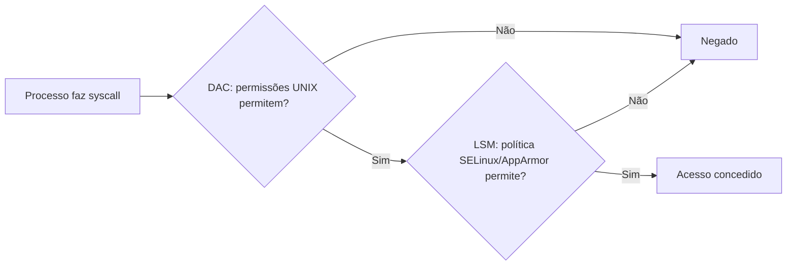

# SELinux e AppArmor

## Resumo

Ambos são **módulos de segurança do Linux (LSM)** que implementam **MAC** (controle de acesso obrigatório): além das permissões UNIX (DAC), cada acesso passa por uma **política central** que nem o `root` consegue contornar facilmente. Se um serviço for comprometido, o MAC limita o que ele alcança.



## Comparação

| Aspecto | SELinux | AppArmor |
|---|---|---|
| Modelo | **Rótulos** (contextos) em processos e objetos | **Caminhos** (perfis por programa) |
| Origem | NSA / Red Hat | Immunix / Canonical / SUSE |
| Distribuições | RHEL, Fedora, CentOS, Android | Ubuntu, Debian, SUSE |
| Granularidade | Muito fina, cobre mais tipos de objetos | Mais simples, foco em arquivos/rede/capabilities |
| Curva de aprendizado | Alta | Moderada |
| Resistência a renomear/linkar arquivos | Alta (rótulo acompanha o inode) | Menor (depende do caminho) |

## SELinux

**Contexto**: `usuário:papel:tipo:nível`. A decisão principal é por **tipo** (*Type Enforcement*): o domínio do processo (`httpd_t`) pode acessar o tipo do arquivo (`httpd_sys_content_t`)?

```bash
getenforce                              # Enforcing | Permissive | Disabled
sudo setenforce 0                       # permissivo temporário (apenas registra)
sestatus
ls -Z /var/www/html                     # contexto dos arquivos
ps -eZ | grep httpd                     # contexto dos processos
id -Z                                   # meu contexto
```

Saída comentada:

```text
$ ps -eZ | grep httpd
system_u:system_r:httpd_t:s0   1320 ?   00:00:00 httpd      # processo no domínio httpd_t
$ ls -Z /var/www/html/index.html
unconfined_u:object_r:httpd_sys_content_t:s0 index.html     # tipo permitido para httpd
```

Cenário típico: servir conteúdo de uma pasta fora do padrão.

```bash
# Erro: httpd não consegue ler /srv/meusite (tipo errado)
sudo semanage fcontext -a -t httpd_sys_content_t "/srv/meusite(/.*)?"
sudo restorecon -Rv /srv/meusite        # aplica o rótulo
# Booleans: ligar/desligar comportamentos
getsebool -a | grep httpd
sudo setsebool -P httpd_can_network_connect on
```

Diagnóstico de negações:

```bash
sudo ausearch -m AVC -ts recent
sudo journalctl -t setroubleshoot
sudo sealert -a /var/log/audit/audit.log      # explica e sugere correção
sudo ausearch -m AVC -ts recent | audit2allow -M meumodulo   # gera política
sudo semodule -i meumodulo.pp
```

> [!warning] Não desligue o SELinux
> Desativá-lo é o conselho ruim mais comum. Use o modo **permissivo** para diagnosticar, corrija rótulos e *booleans*, e crie módulos apenas para exceções legítimas.

## AppArmor

Perfis por executável, em `/etc/apparmor.d/`. Modos: **enforce** e **complain** (registra, não bloqueia).

```text
# /etc/apparmor.d/usr.bin.meuapp
#include <tunables/global>
/usr/bin/meuapp {
  #include <abstractions/base>
  capability net_bind_service,
  network inet stream,
  /etc/meuapp/** r,
  /var/lib/meuapp/** rw,
  /var/log/meuapp.log w,
  deny /home/** rwx,
}
```

```bash
sudo aa-status                          # perfis carregados e modo
sudo aa-genprof /usr/bin/meuapp         # gera perfil interativamente observando o uso
sudo aa-complain /usr/bin/meuapp        # modo aprendizado
sudo aa-enforce  /usr/bin/meuapp
sudo apparmor_parser -r /etc/apparmor.d/usr.bin.meuapp   # recarrega
sudo dmesg | grep -i apparmor           # negativas (ALLOWED/DENIED)
```

## Outros LSM e contexto

| LSM | Foco |
|---|---|
| **Landlock** | Auto-restrição por processo sem privilégios |
| **Smack**, **TOMOYO** | MAC alternativos (Tizen, nicho) |
| **Yama** | Restringe `ptrace` |
| **Lockdown** | Impede que root modifique o kernel (Secure Boot) |
| **IMA/EVM** | Integridade de arquivos e atestação |

Em **Android**, o SELinux é obrigatório e separa apps entre si e do sistema. Em contêineres, Docker/Podman aplicam perfis AppArmor/SELinux por padrão ([[Containers]]).

## Vantagens e desvantagens

| | Vantagens | Desvantagens |
|---|---|---|
| **SELinux** | Controle extremamente fino; contém *zero-days*; resiste a renomeações | Complexo; mensagens difíceis; exige rotulagem correta |
| **AppArmor** | Fácil de ler e escrever; bom para perfis rápidos | Menos poderoso; baseado em caminhos pode ser contornado por links/montagens |

## Pontos-chave

- MAC aplica uma política central além do DAC.
- SELinux = rótulos/tipos; AppArmor = perfis por caminho.
- Em problemas, use modo permissivo/complain e ferramentas de auditoria, não desative.

## Veja também

[[Controle de Acesso]] · [[Sandboxing]] · [[MOC - Segurança - SO]]
