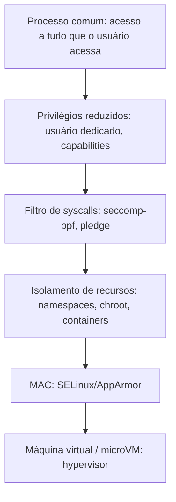
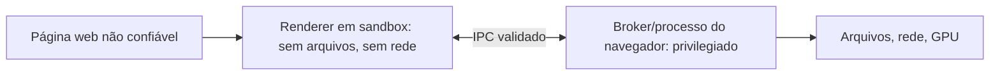

# Sandboxing

## Resumo

**Sandbox** é um ambiente restrito em que um programa roda com **o mínimo de acesso** a arquivos, rede, dispositivos e chamadas de sistema. O objetivo é **conter o dano** caso o programa seja comprometido. Parte do princípio: **assuma que o código terá falhas**.

## Camadas de isolamento



Quanto mais abaixo, mais forte (e mais caro) o isolamento.

## Mecanismos por SO

| Mecanismo | SO | Descrição |
|---|---|---|
| **seccomp / seccomp-bpf** | Linux | Filtra quais [[System Calls]] o processo pode chamar; violação = `SIGSYS`/morte |
| **Namespaces** | Linux | Visões isoladas de PIDs, rede, montagens, usuários ([[Containers]]) |
| **chroot / pivot_root** | UNIX | Muda a raiz; sozinho **não** é segurança |
| **Landlock** | Linux 5.13+ | Processo restringe a si mesmo (arquivos/rede) sem root |
| **bubblewrap, Firejail** | Linux | Ferramentas de sandbox em user space (Flatpak usa bubblewrap) |
| **pledge / unveil** | OpenBSD | Declara que syscalls e caminhos usará |
| **Capsicum** | FreeBSD | Capabilities para descritores |
| **App Sandbox, Seatbelt** | macOS/iOS | Entitlements declarados; perfis em SBPL |
| **AppContainer, Job objects, integridade baixa** | Windows | Sandbox de apps UWP e navegadores |
| **Android app sandbox** | Android | UID por app + SELinux + seccomp ([[SO Mobile]]) |
| **gVisor, Firecracker, Kata** | Nuvem | Kernel em user space ou microVMs |
| **WebAssembly (WASI)** | Multiplataforma | Sandbox por linguagem/runtime com capabilities |

## Exemplo: filtro seccomp

```c
#include <seccomp.h>
#include <stdio.h>
#include <unistd.h>

int main(void) {
    scmp_filter_ctx ctx = seccomp_init(SCMP_ACT_KILL);       // nega tudo por padrão
    seccomp_rule_add(ctx, SCMP_ACT_ALLOW, SCMP_SYS(write), 0);
    seccomp_rule_add(ctx, SCMP_ACT_ALLOW, SCMP_SYS(exit_group), 0);
    seccomp_load(ctx);

    write(1, "permitido\n", 10);
    open("/etc/passwd", 0);          // negado: o processo é encerrado
    return 0;
}
```

```bash
gcc seccomp_demo.c -lseccomp -o sec && ./sec
echo $?                              # 159 = SIGSYS
grep Seccomp /proc/self/status       # 0 off, 1 estrito, 2 filtro
```

## Exemplo: bubblewrap e systemd

```bash
# Roda um comando sem rede e com o sistema montado só leitura
bwrap --ro-bind /usr /usr --symlink usr/lib /lib --symlink usr/lib64 /lib64 \
      --proc /proc --dev /dev --unshare-all --die-with-parent /bin/sh

# Serviços systemd com sandbox declarativo
systemd-analyze security meuapp.service
```

```ini
[Service]
NoNewPrivileges=yes
PrivateTmp=yes
ProtectSystem=strict
ProtectHome=yes
PrivateNetwork=yes
SystemCallFilter=@system-service
CapabilityBoundingSet=
MemoryDenyWriteExecute=yes
```

## Exemplo: navegador

Chrome e Firefox usam **multiprocesso**: o processo do *renderer* (que executa conteúdo não confiável) roda em sandbox sem acesso a arquivos ou rede, e fala com o processo *broker* privilegiado por IPC. Uma falha no renderer exige **uma segunda vulnerabilidade** (escape do sandbox) para causar dano real.



## Limites

> [!warning] Sandbox não é perfeito
> - Falhas no **kernel** ou no **hypervisor** permitem escape.
> - Políticas muito amplas anulam a proteção (ex.: `--privileged` em Docker).
> - Canais laterais (Spectre) cruzam fronteiras de processo.
> - Compatibilidade: sandboxes muito restritos quebram aplicativos.

## Vantagens e desvantagens

| Vantagens | Desvantagens |
|---|---|
| Limita o impacto de vulnerabilidades | Esforço de projeto e manutenção das políticas |
| Aplica o menor privilégio automaticamente | Pode afetar o desempenho (filtros, IPC extra) |
| Defesa em profundidade | Falsa sensação de segurança se mal configurado |

## Pontos-chave

- Contenção: reduzir o que um processo pode fazer.
- Combine privilégios mínimos, seccomp, namespaces e MAC.
- Para código muito hostil, use microVMs.

## Veja também

[[Controle de Acesso]] · [[SELinux e AppArmor]] · [[Containers]] · [[MOC - Segurança - SO]]
