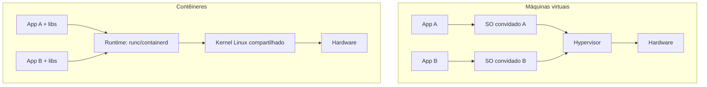
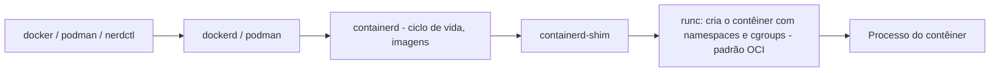

# Containers

## Resumo

Um **contêiner** é um **processo (ou grupo de processos) isolado** que enxerga um sistema próprio de arquivos, rede, PIDs e usuários, mas **compartilha o kernel do host**. Não é uma entidade do kernel: é a **combinação** de [[Namespaces do Linux - SO]] (isolamento), [[cgroups - SO]] (limites) e outros mecanismos de [[Sandboxing]] (capabilities, seccomp, MAC), mais um **sistema de arquivos em camadas** (imagem).

## Contêiner x VM



| Aspecto | Contêiner | VM |
|---|---|---|
| Kernel | **Compartilhado** com o host | **Próprio** de cada VM |
| Inicialização | Milissegundos | Segundos |
| Tamanho | MBs | GBs |
| Densidade | Centenas por host | Dezenas |
| Isolamento | Médio (superfície = syscalls do kernel) | Forte (superfície = hypervisor) |
| SO convidado | Mesmo kernel (Linux em Linux) | Qualquer |
| Desempenho | Quase nativo | Pequena perda |

> [!warning] Contêiner não é fronteira de segurança forte
> Uma vulnerabilidade do kernel pode ser explorada de dentro de um contêiner. Para multi-inquilino hostil, use **microVMs** (Firecracker, Kata) ou **gVisor**.

## Como o Linux cria um contêiner (na mão)

```bash
# 1. Preparar um sistema de arquivos raiz
mkdir rootfs && sudo debootstrap --variant=minbase stable rootfs   # ou: docker export
# 2. Novos namespaces + chroot
sudo unshare --pid --fork --mount --uts --ipc --net --mount-proc \
     chroot rootfs /bin/bash
# Dentro: ps aux mostra só poucos processos; hostname é independente
# 3. Limitar recursos com cgroup v2
sudo mkdir /sys/fs/cgroup/meu
echo "50000 100000" | sudo tee /sys/fs/cgroup/meu/cpu.max      # 50% de 1 CPU
echo 256M | sudo tee /sys/fs/cgroup/meu/memory.max
echo $$ | sudo tee /sys/fs/cgroup/meu/cgroup.procs
```

## Componentes da pilha



| Padrão / projeto | Papel |
|---|---|
| **OCI** (Open Container Initiative) | Especificações de **imagem** e de **runtime** |
| **runc**, crun | Runtimes de baixo nível |
| **containerd**, **CRI-O** | Runtimes de alto nível; usados pelo Kubernetes (CRI) |
| **Podman, Buildah** | Alternativa sem daemon, *rootless* |
| **Kubernetes** | Orquestração de contêineres em cluster |
| **LXC/LXD/Incus** | Contêineres de **sistema** (init completo), parecidos com VMs leves |

## Imagens e camadas

Uma imagem é um conjunto de **camadas somente leitura** (tar), empilhadas por um sistema de arquivos de união (**overlayfs**), mais uma camada **gravável** por contêiner (*copy-on-write*). Camadas são **compartilhadas** entre imagens e identificadas por *digest* (SHA-256).

```bash
docker image inspect nginx --format '{{json .RootFS.Layers}}' | jq
mount | grep overlay                         # overlayfs de um contêiner em execução
ls /var/lib/docker/overlay2 | head
```

## Rede e armazenamento

- **Rede**: *namespace* de rede por contêiner + par `veth` ligado a uma **bridge** (`docker0`), NAT com iptables/nftables; modos `host`, `none`, `macvlan`, *overlay* (multi-host).
- **Armazenamento**: camada efêmera, **volumes** (gerenciados), **bind mounts** (pasta do host), `tmpfs`.

## Rootless e segurança

```bash
podman run --rm -it --userns=keep-id alpine id        # sem daemon e sem root no host
docker run --read-only --cap-drop ALL --security-opt no-new-privileges \
           --pids-limit 100 --memory 256m alpine
```

Boas práticas: **usuário não-root** na imagem, `--cap-drop ALL`, perfil seccomp padrão, AppArmor/SELinux, sistema de arquivos somente leitura, imagens mínimas (distroless/alpine), varredura de CVEs, evitar `--privileged` e montar `docker.sock`.

## Inspeção no host

```bash
ps -eo pid,pidns,cmd | head                 # PIDs por namespace
lsns                                        # lista namespaces
sudo nsenter -t <PID> -n ip addr            # entra no namespace de rede do contêiner
cat /proc/<PID>/cgroup
systemd-cgls                                # árvore de cgroups
```

## Vantagens e desvantagens

| Vantagens | Desvantagens |
|---|---|
| Inicialização e densidade excelentes | Kernel compartilhado: isolamento mais fraco |
| Portabilidade: "roda igual em qualquer lugar" | Só Linux em Linux (no Windows/macOS há VM por baixo) |
| Imagens imutáveis e reprodutíveis | Estado persistente exige volumes |
| Base de microsserviços e CI/CD | Complexidade de rede, segurança e observabilidade |

## Pontos-chave

- Contêiner = processo + namespaces + cgroups + overlayfs.
- Compartilha o kernel: leve, porém menos isolado que VM.
- OCI padroniza imagens e runtimes (runc, containerd).

## Veja também

[[Namespaces do Linux - SO]] · [[cgroups - SO]] · [[Docker]] · [[MOC - Virtualização e Containers]]
