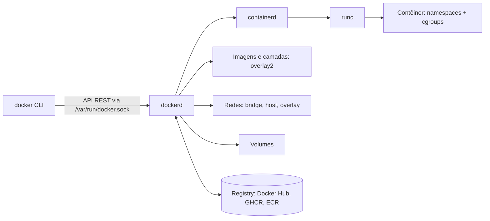

# Docker

## Resumo

O **Docker** popularizou os [[Containers|contêineres]] ao oferecer uma experiência simples para **empacotar** (imagens), **distribuir** (registries) e **executar** aplicações. Por baixo, usa [[Namespaces do Linux - SO]], [[cgroups - SO]], overlayfs e o runtime OCI (`containerd` + `runc`).

## Arquitetura



> [!warning] `docker.sock`
> Quem acessa o socket do Docker controla o daemon (que roda como root): equivale a **root no host**. O grupo `docker` é, na prática, administrativo.

## Conceitos

| Conceito | Descrição |
|---|---|
| **Imagem** | Modelo imutável: camadas + metadados (entrypoint, env, portas) |
| **Contêiner** | Instância em execução (ou parada) de uma imagem |
| **Dockerfile** | Receita de construção; cada instrução gera uma camada |
| **Registry** | Repositório de imagens (`nome:tag` ou `@sha256:digest`) |
| **Volume / bind mount** | Persistência fora da camada gravável |
| **Rede** | `bridge` (padrão), `host`, `none`, `overlay`, `macvlan` |
| **Compose** | Define aplicações multicontêiner em YAML |

## Comandos essenciais

```bash
docker run -d --name web -p 8080:80 nginx          # executa em segundo plano; porta host:contêiner
docker ps; docker ps -a                            # em execução / todos
docker logs -f web
docker exec -it web sh                             # shell dentro do contêiner
docker stop web && docker rm web
docker images; docker pull alpine:3.20
docker inspect web | jq '.[0].State, .[0].HostConfig.Memory'
docker stats                                       # CPU/memória em tempo real
docker system df; docker system prune              # espaço e limpeza
docker top web; docker diff web                    # processos e alterações no FS
```

## Dockerfile

```dockerfile
# Build em múltiplos estágios: imagem final pequena e sem ferramentas de compilação
FROM golang:1.23 AS build
WORKDIR /src
COPY go.mod go.sum ./
RUN go mod download                  # camada cacheada enquanto as dependências não mudam
COPY . .
RUN CGO_ENABLED=0 go build -o /app ./cmd/servidor

FROM gcr.io/distroless/static:nonroot
COPY --from=build /app /app
USER nonroot:nonroot
EXPOSE 8080
ENTRYPOINT ["/app"]
```

```bash
docker build -t meuapp:1.0 .
docker run --rm -p 8080:8080 meuapp:1.0
docker history meuapp:1.0                         # camadas e tamanhos
```

**Cache de camadas**: ordene as instruções da menos para a mais mutável (dependências antes do código). Use `.dockerignore`.

## Dados e redes

```bash
docker volume create dados
docker run -d -v dados:/var/lib/postgresql/data -e POSTGRES_PASSWORD=x postgres:16
docker run --rm -v "$PWD":/work -w /work alpine ls       # bind mount
docker network create rede
docker run -d --network rede --name db postgres:16
docker run --network rede alpine ping -c1 db             # DNS interno por nome
```

## Docker Compose

```yaml
# compose.yaml
services:
  web:
    build: .
    ports: ["8080:8080"]
    environment:
      DATABASE_URL: postgres://app:segredo@db:5432/app
    depends_on:
      db: { condition: service_healthy }
    read_only: true
    cap_drop: [ALL]
    deploy:
      resources:
        limits: { cpus: "1.0", memory: 512M }
  db:
    image: postgres:16
    environment: { POSTGRES_USER: app, POSTGRES_PASSWORD: segredo, POSTGRES_DB: app }
    volumes: [dados:/var/lib/postgresql/data]
    healthcheck:
      test: ["CMD-SHELL", "pg_isready -U app"]
      interval: 5s
volumes:
  dados:
```

```bash
docker compose up -d
docker compose ps; docker compose logs -f web
docker compose down -v
```

## Boas práticas de segurança e operação

| Prática | Motivo |
|---|---|
| Rodar como **usuário não-root** (`USER`) | Reduz impacto de escape |
| Imagens **mínimas** e fixadas por digest | Menos CVEs e builds reproduzíveis |
| `--read-only`, `--cap-drop ALL`, `no-new-privileges` | Menor privilégio |
| Nunca usar `--privileged` ou montar `docker.sock` | Equivalem a root no host |
| Segredos via secrets/variáveis de ambiente de runtime, **não** `ENV`/`COPY` na imagem | Imagens vazam em registries |
| Escanear imagens (Trivy, Grype) e assinar (cosign) | Cadeia de suprimentos |
| Limitar recursos (`--memory`, `--cpus`, `--pids-limit`) | Evita vizinho barulhento |
| Um processo por contêiner, tratar sinais (`--init`) | PID 1 não coleta zumbis por padrão |
| Logs em stdout/stderr | Coleta por drivers de log |

```bash
trivy image meuapp:1.0                    # vulnerabilidades
docker run --init --rm meuapp:1.0
docker scout quickview meuapp:1.0         # alternativa da Docker
```

## Docker em Windows e macOS

Contêineres Linux precisam do **kernel Linux**: o Docker Desktop executa uma **VM leve** (WSL 2 no Windows, Apple Virtualization/QEMU no macOS). Contêineres **Windows** nativos usam o kernel NT (isolamento por processo ou Hyper-V).

## Alternativas

Podman (sem daemon, *rootless*), containerd + nerdctl, Buildah/Kaniko (builds), LXC/Incus (contêineres de sistema), Kubernetes para orquestração.

## Vantagens e desvantagens

| Vantagens | Desvantagens |
|---|---|
| Ambientes reprodutíveis e portáteis | Daemon com privilégio de root (no modo padrão) |
| Ecossistema enorme (Hub, Compose) | Imagens grandes ou desatualizadas trazem CVEs |
| Isolamento leve e rápido | Isolamento mais fraco que VM |
| Integra com CI/CD e orquestradores | Persistência e rede exigem atenção |

## Pontos-chave

- Docker = CLI + `dockerd` + `containerd` + `runc` sobre namespaces e cgroups.
- Imagens em camadas imutáveis; contêiner = camada gravável + processo.
- Segurança: não-root, capabilities mínimas, sem `--privileged`.

## Veja também

[[Containers]] · [[Namespaces do Linux - SO]] · [[cgroups - SO]] · [[MOC - Virtualização e Containers]]
