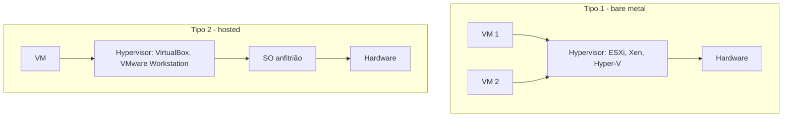
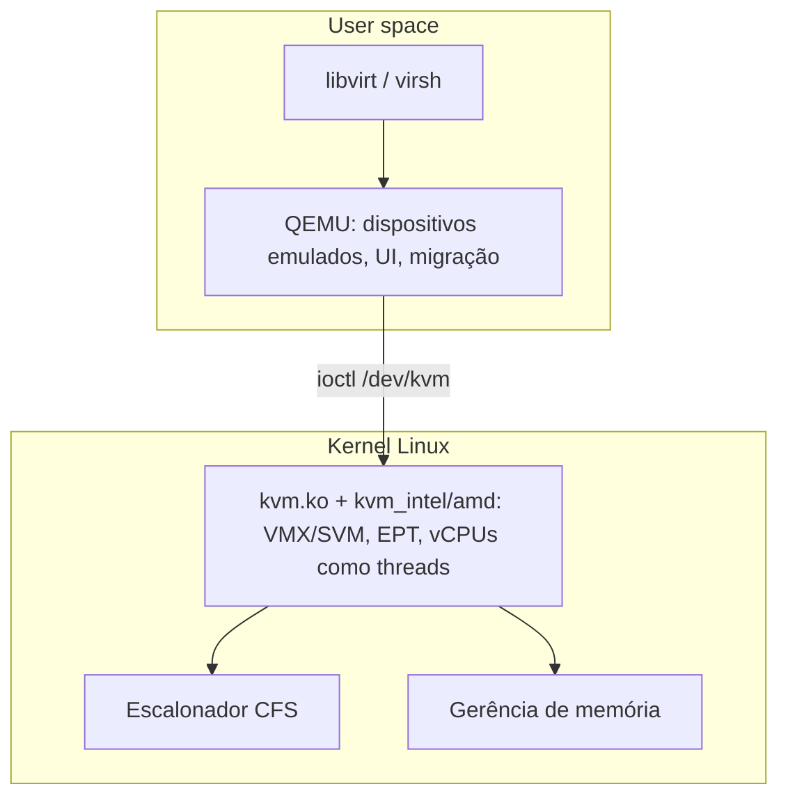

# Hypervisors

## Resumo

O **hypervisor** é o software (ou firmware) que cria e executa VMs. Classificam-se em **tipo 1** (*bare metal*, sobre o hardware) e **tipo 2** (*hosted*, como aplicação de um SO anfitrião).



> [!info] KVM é tipo 1 ou 2?
> O **KVM** transforma o kernel Linux em hypervisor tipo 1 (módulo `kvm`); o **QEMU** em user space emula dispositivos. Como o Linux é o próprio hypervisor, na prática é tipo 1, embora o Linux seja também um SO de uso geral. O **Hyper-V** também roda sobre o hardware com o Windows como partição raiz (pai).

## Principais hypervisors

| Hypervisor | Tipo | Arquitetura | Uso |
|---|---|---|---|
| **KVM + QEMU** | 1 (kernel Linux) | Monolítico (módulo do kernel) | Nuvem (AWS Nitro baseado em KVM, GCP, OpenStack), Proxmox |
| **Xen** | 1 | Microkernel; **dom0** privilegiado + domUs | AWS (histórico), XCP-ng, Qubes OS |
| **VMware ESXi** | 1 | VMkernel proprietário | Datacenters corporativos |
| **Microsoft Hyper-V** | 1 | Microkernel; partição raiz + filhas | Windows Server, Azure, WSL2, VBS/Credential Guard |
| **VirtualBox** | 2 | Módulos + user space | Desktop, desenvolvimento |
| **VMware Workstation/Fusion** | 2 | - | Desktop |
| **Parallels, UTM (QEMU/Apple Hypervisor.framework)** | 2 | - | macOS |
| **bhyve** | 1 (FreeBSD) | Módulo do kernel | FreeBSD |
| **Firecracker, Cloud Hypervisor** | VMM mínimo sobre KVM | Rust, microVMs | AWS Lambda/Fargate |

## Estrutura do KVM



- Cada **vCPU** é uma **thread** do host, escalonada pelo Linux ([[CFS - Completely Fair Scheduler]]), com `cgroups` e afinidade.
- A memória da VM é memória virtual do processo QEMU: **KSM**, *hugepages* e *ballooning* funcionam naturalmente.

```bash
# API do KVM: um programa mínimo cria uma VM e uma vCPU
# (esqueleto simplificado)
```

```c
#include <fcntl.h>
#include <linux/kvm.h>
#include <sys/ioctl.h>
#include <sys/mman.h>
#include <stdio.h>

int main(void) {
    int kvm = open("/dev/kvm", O_RDWR);
    printf("API KVM versão %d\n", ioctl(kvm, KVM_GET_API_VERSION, 0));   // 12
    int vm   = ioctl(kvm, KVM_CREATE_VM, 0);
    int vcpu = ioctl(vm, KVM_CREATE_VCPU, 0);
    /* mapear memória: KVM_SET_USER_MEMORY_REGION; configurar registradores: KVM_SET_REGS;
       laço: ioctl(vcpu, KVM_RUN, 0) e tratar VM exits (E/S, HLT, ...) */
    return 0;
}
```

## Recursos de gestão

| Recurso | Descrição |
|---|---|
| **Migração ao vivo** | vMotion (VMware), `virsh migrate --live`, Hyper-V Live Migration |
| **HA e failover** | Reinicia VMs de hosts falhos em outros nós |
| **Snapshots e clones** | Estado e disco; clones *linked* (qcow2 backing) |
| **Overcommit** | Mais vCPUs/RAM virtuais que físicos; riscos de contenção |
| **Passagem de dispositivos** | GPU, NIC (VFIO + IOMMU) |
| **NUMA-aware** | Alocar vCPUs e memória no mesmo nó NUMA |
| **Confidential computing** | AMD SEV-SNP, Intel TDX: memória da VM cifrada contra o próprio hypervisor |

```bash
sudo virt-install --name web01 --memory 2048 --vcpus 2 \
  --disk size=20,format=qcow2 --os-variant ubuntu24.04 \
  --cdrom ubuntu.iso --network network=default
virsh dominfo web01
virsh vcpupin web01 0 2                 # fixa a vCPU 0 na CPU física 2
virsh setmem web01 1G --live            # ballooning
virsh migrate --live web01 qemu+ssh://host2/system
```

## Segurança

> [!warning] Escape de VM
> Falhas no hypervisor ou em dispositivos emulados (ex.: *VENOM*, floppy) permitem a um convidado atacar o host. Mitigações: **VMM mínimo e em Rust** (Firecracker), **sandbox do processo QEMU** (seccomp, SELinux `svirt`), atualizações, IOMMU, *confidential VMs*. Canais laterais (L1TF, MDS) exigem **desativar SMT** ou escalonar *core scheduling* para inquilinos diferentes.

## Vantagens e desvantagens por tipo

| Tipo | Vantagens | Desvantagens |
|---|---|---|
| **Tipo 1** | Desempenho e isolamento; menor superfície; recursos corporativos | Hardware dedicado; administração mais complexa |
| **Tipo 2** | Fácil de instalar e usar; ótimo para desktop e testes | Camada extra (SO anfitrião); menor desempenho e isolamento |

## Pontos-chave

- Tipo 1 roda sobre o hardware; tipo 2 sobre um SO.
- KVM torna o Linux um hypervisor; vCPUs são threads.
- VMM mínimos (Firecracker) e *confidential computing* fortalecem a segurança.

## Veja também

[[Virtualização]] · [[Containers]] · [[MOC - Virtualização e Containers]]
