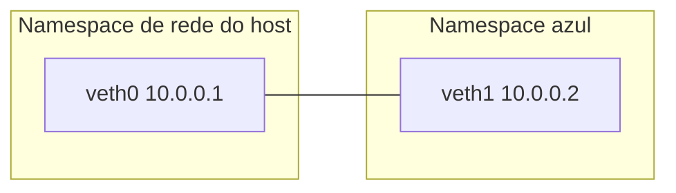

# Namespaces do Linux - SO

## Resumo

Um **namespace** faz com que um processo enxergue uma **visão própria e isolada** de um recurso global do sistema. Dois processos em namespaces diferentes podem usar o mesmo PID, a mesma porta ou o mesmo nome de host sem conflito. É o mecanismo de **"o que o contêiner enxerga"** ([[Containers]]).

## Tipos

| Namespace | Flag | Isola | Efeito |
|---|---|---|---|
| **PID** | `CLONE_NEWPID` | Árvore de PIDs | Primeiro processo é PID 1 interno; não vê processos de fora |
| **Mount (MNT)** | `CLONE_NEWNS` | Pontos de montagem | Sistema de arquivos raiz próprio |
| **Network (NET)** | `CLONE_NEWNET` | Interfaces, rotas, firewall, portas | Pilha de rede independente |
| **UTS** | `CLONE_NEWUTS` | Hostname e domínio | Nome de host próprio |
| **IPC** | `CLONE_NEWIPC` | Filas de mensagens, semáforos e memória compartilhada SysV | IPC isolado |
| **User** | `CLONE_NEWUSER` | UIDs/GIDs | **root dentro = usuário comum fora** (base do *rootless*) |
| **Cgroup** | `CLONE_NEWCGROUP` | Raiz da hierarquia de cgroups | Contêiner vê só seu cgroup |
| **Time** | `CLONE_NEWTIME` | Relógios monotônico e de boot | Contêineres com tempo ajustado |

## Chamadas de sistema

| Syscall / comando | Função |
|---|---|
| `clone(flags)` | Cria processo já em novos namespaces |
| `unshare(flags)` | O processo atual **sai** de namespaces e entra em novos |
| `setns(fd, tipo)` | **Entra** em um namespace existente (via `/proc/PID/ns/*`) |
| `unshare`, `nsenter`, `lsns`, `ip netns` | Ferramentas de linha de comando |

```bash
ls -l /proc/self/ns/                         # um link por tipo; mesmo ID = mesmo namespace
lsns                                         # lista todos
sudo unshare --pid --fork --mount-proc bash  # novo namespace de PID
#   ps aux  → somente 2 processos; o bash é PID 1
sudo unshare --uts bash -c 'hostname isolado; hostname'; hostname   # não afeta o host
unshare --user --map-root-user bash -c 'id'  # uid=0(root) DENTRO; sem privilégio real fora
```

## Exemplo em C: `clone` com novo namespace de PID e UTS

```c
#define _GNU_SOURCE
#include <sched.h>
#include <stdio.h>
#include <stdlib.h>
#include <sys/wait.h>
#include <unistd.h>

static char pilha[1024 * 1024];

int filho(void *arg) {
    sethostname("meu-conteiner", 13);                  // só neste namespace UTS
    printf("filho: PID=%d (visão interna)\n", getpid());   // imprime 1
    execlp("sh", "sh", NULL);
    return 1;
}

int main(void) {
    pid_t p = clone(filho, pilha + sizeof pilha,
                    CLONE_NEWPID | CLONE_NEWUTS | SIGCHLD, NULL);   // requer root
    printf("pai: PID real do filho=%d\n", p);
    waitpid(p, NULL, 0);
    return 0;
}
```

## Rede: `ip netns`

```bash
sudo ip netns add azul
sudo ip link add veth0 type veth peer name veth1
sudo ip link set veth1 netns azul
sudo ip addr add 10.0.0.1/24 dev veth0 && sudo ip link set veth0 up
sudo ip netns exec azul ip addr add 10.0.0.2/24 dev veth1
sudo ip netns exec azul ip link set veth1 up
sudo ip netns exec azul ping -c1 10.0.0.1             # comunicação entre os namespaces
```



## User namespaces e segurança

Mapeiam UIDs (`/proc/PID/uid_map`): o UID 0 do contêiner pode ser o UID 100000 no host. Habilitam **contêineres sem root** (Podman rootless, bubblewrap). Mas ampliam a superfície do kernel, e algumas distribuições limitam o uso por usuários comuns (`kernel.unprivileged_userns_clone`, AppArmor no Ubuntu).

> [!warning] Namespace ≠ segurança completa
> Não isolam tudo: o **kernel**, `/proc/sys`, relógios (antes do time ns), `dmesg` e módulos são compartilhados. Combine com [[cgroups - SO]], seccomp, capabilities e MAC.

## Outros sistemas

| SO | Equivalente |
|---|---|
| FreeBSD | **Jails** |
| Solaris | **Zones** |
| Windows | **Job objects, Silos** (contêineres Windows), Hyper-V isolation |
| macOS | Sem contêineres nativos; Docker usa VM |

## Pontos-chave

- Namespace = visão isolada de um recurso global (PID, rede, mount, UTS, IPC, user, cgroup, time).
- `clone`, `unshare` e `setns` criam e entram nos namespaces.
- User namespace é a base dos contêineres *rootless*.

## Veja também

[[Containers]] · [[cgroups - SO]] · [[MOC - Virtualização e Containers]]
