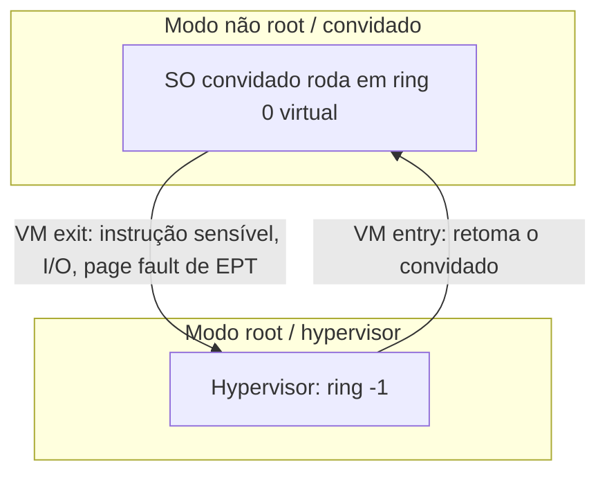

# Virtualização

## Resumo

**Virtualização** cria **versões virtuais** de recursos (CPU, memória, disco, rede) para que várias **máquinas virtuais (VMs)**, cada uma com seu SO convidado (*guest*), compartilhem o mesmo hardware com isolamento. O software que faz isso é o **hypervisor** ou **VMM** (*Virtual Machine Monitor*).

## Requisitos de Popek e Goldberg (1974)

Um VMM eficiente deve garantir **equivalência** (comporta-se como a máquina real), **controle de recursos** (domina o hardware) e **eficiência** (a maioria das instruções executa direto na CPU). Isso exige que as instruções **sensíveis** sejam também **privilegiadas** (gerem *trap* no modo usuário). O x86 clássico violava isso (17 instruções sensíveis não privilegiadas), motivando as técnicas abaixo.

## Técnicas

| Técnica | Como funciona | Exemplos |
|---|---|---|
| **Emulação completa** | Interpreta cada instrução do convidado | QEMU (TCG), emuladores de console |
| **Tradução binária** | Reescreve em tempo real instruções problemáticas | VMware (início), VirtualBox antigo |
| **Paravirtualização** | O SO convidado é modificado e chama o hypervisor (*hypercalls*) | Xen PV, drivers **virtio** |
| **Virtualização assistida por hardware** | CPU com modos extras: VT-x (Intel), AMD-V, ARM EL2, RISC-V H | KVM, Hyper-V, Xen HVM, VMware |

## Suporte de hardware



| Componente | Função |
|---|---|
| **VMCS / VMCB** | Estrutura com o estado da CPU virtual |
| **VM exit / entry** | Transição convidado ↔ hypervisor (custosa: evitar) |
| **EPT / NPT** (*nested paging*) | A MMU faz tradução em dois níveis: virtual convidada → física convidada → física real; elimina *shadow page tables* |
| **IOMMU (VT-d / AMD-Vi)** | Isola e traduz DMA de dispositivos; permite passagem direta ([[DMA - Acesso Direto à Memória]]) |
| **SR-IOV** | Placa PCIe se apresenta como várias funções virtuais |
| **APICv / posted interrupts** | Reduz VM exits em interrupções |

## Virtualização de cada recurso

| Recurso | Abordagem |
|---|---|
| **CPU** | Execução direta; escalonamento de vCPUs em CPUs físicas |
| **Memória** | EPT/NPT; *ballooning* (devolver memória do convidado), KSM (dedup), *overcommit* |
| **Disco** | Imagens (`qcow2`, `vmdk`, `vhdx`), LVM, discos virtio-blk/virtio-scsi |
| **Rede** | Bridge, NAT, `tap`, switches virtuais (Open vSwitch), virtio-net, SR-IOV |
| **Dispositivos** | Emulação, **virtio** (paravirtual), passagem direta (VFIO) |

> [!tip] virtio
> Padrão de dispositivos paravirtualizados: o convidado sabe que está em VM e usa filas compartilhadas (*virtqueues*) em vez de emular hardware real. É a base de desempenho em KVM/nuvem.

## Outros tipos de virtualização

| Tipo | Descrição |
|---|---|
| **Virtualização de SO** | [[Containers]]: um kernel, vários ambientes |
| **Virtualização de aplicações / runtime** | JVM, .NET CLR, WebAssembly |
| **Virtualização de rede** | VLAN, VXLAN, redes sobrepostas |
| **Virtualização de armazenamento** | LVM, SAN, Ceph |
| **Aninhada** (*nested*) | VM dentro de VM (testes, nuvem) |

## Exemplo prático

```bash
# O CPU suporta virtualização por hardware?
lscpu | grep -i virtualization
grep -E -o 'vmx|svm' /proc/cpuinfo | sort -u    # vmx = Intel, svm = AMD
ls /dev/kvm                                      # KVM disponível
systemd-detect-virt                              # "kvm", "none", "docker"... onde estou?
lsmod | grep kvm

# Criar e executar uma VM com QEMU/KVM
qemu-img create -f qcow2 disco.qcow2 20G
qemu-system-x86_64 -enable-kvm -m 2048 -smp 2 \
  -drive file=disco.qcow2,if=virtio \
  -cdrom debian.iso -boot d \
  -nic user,model=virtio-net-pci
```

```powershell
# Windows: Hyper-V
Get-WindowsOptionalFeature -Online -FeatureName Microsoft-Hyper-V
Get-VM; New-VM -Name teste -MemoryStartupBytes 2GB -NewVHDPath C:\vm\teste.vhdx -NewVHDSizeBytes 30GB
```

```bash
# Gerenciar com libvirt
virsh list --all
virsh start minhavm
virsh snapshot-create-as minhavm antes-upgrade
virsh domifaddr minhavm
```

## Casos de uso

Consolidação de servidores, nuvem pública (EC2, GCE, Azure), ambientes de teste e CI, isolamento forte (multitenant, segurança), compatibilidade com SO legado, recuperação de desastres e migração ao vivo.

## Migração ao vivo e snapshots

**Live migration**: copia iterativamente a memória da VM para outro host enquanto roda (*pre-copy*), pausa por milissegundos para as últimas páginas sujas e retoma no destino. **Snapshots** guardam disco e estado de memória.

## Vantagens e desvantagens

| Vantagens | Desvantagens |
|---|---|
| Isolamento forte (kernel próprio) | Sobrecarga de memória e inicialização |
| Roda SOs diferentes no mesmo hardware | VM exits e E/S emulada reduzem desempenho (mitigado por virtio e passagem) |
| Migração ao vivo, snapshots, alta disponibilidade | Superfície de ataque do hypervisor (escape de VM) |
| Consolidação de hardware | Canais laterais entre VMs vizinhas (Spectre, cache) |

## Pontos-chave

- Hypervisor multiplexa o hardware entre SOs convidados.
- VT-x/AMD-V + EPT + IOMMU + virtio dão desempenho próximo ao nativo.
- Contêineres virtualizam o SO; VMs virtualizam o hardware.

## Veja também

[[Hypervisors]] · [[Containers]] · [[MOC - Virtualização e Containers]]
