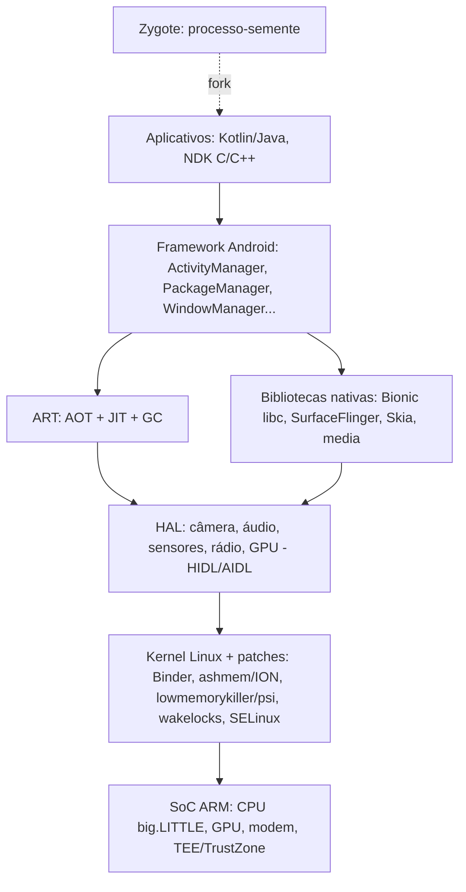

# Android

## Resumo

O **Android** (Google/AOSP) é um SO móvel baseado em um **kernel Linux** (Android Common Kernel) com uma **pilha própria** em espaço de usuário: **HAL**, **Android Runtime (ART)**, **Binder** e *framework* Java/Kotlin. O núcleo (AOSP) é código aberto (Apache 2.0); os serviços Google (GMS) são proprietários. É o SO mais usado do mundo.

## Arquitetura



## Elementos-chave

| Elemento | Função |
|---|---|
| **Zygote** | Processo pré-inicializado; cada app é um `fork` dele (inicialização rápida e páginas compartilhadas, COW) |
| **ART** | Compila bytecode DEX: AOT na instalação, JIT e perfis em execução ([[Memória Virtual]]) |
| **Binder** | IPC principal entre apps e serviços do sistema, com identidade do chamador (UID/PID) |
| **Sandbox por app** | Cada app = **UID Linux próprio** + SELinux + seccomp ([[Sandboxing]]) |
| **Permissões** | Em tempo de execução e por escopo (localização aproximada, mídia, notificações) |
| **Verified Boot + AVB** | Cadeia de confiança no boot ([[Processo de Boot]]) |
| **Treble / GKI** | Separam o framework do fornecedor; **Generic Kernel Image** reduz a fragmentação do kernel |
| **Project Mainline** | Atualização de módulos do sistema pela Play Store |
| **Gerência de energia** | Doze, App Standby, JobScheduler/WorkManager, wakelocks |
| **Low Memory Killer (lmkd)** | Encerra apps por pressão de memória (PSI) |
| **Trusty / StrongBox** | Ambiente de execução confiável e chaves em hardware |

## Ferramentas

```bash
adb devices
adb shell getprop ro.build.version.release      # versão do Android
adb shell uname -a                              # kernel Linux
adb shell ps -A | head                          # processos (cada app = um UID)
adb shell dumpsys meminfo com.android.chrome | head -25
adb shell dumpsys battery
adb shell dumpsys activity processes | head
adb shell am start -n com.android.settings/.Settings
adb shell pm list packages -3                   # apps de terceiros
adb logcat -s ActivityManager:I                 # logs
adb shell su -c 'getenforce'                    # SELinux (em dispositivo com root)
adb shell cat /proc/pressure/memory
```

## Vantagens e desvantagens

| Vantagens | Desvantagens |
|---|---|
| Código aberto (AOSP); enorme variedade de dispositivos e preços | Fragmentação de versões e atualizações dependentes do fabricante |
| Personalização e flexibilidade (launchers, sideload, ROMs) | Qualidade e segurança variam entre fabricantes |
| Ecossistema de apps gigante; baseado em Linux | Malware e apps maliciosos fora da loja; permissões confusas |
| Multitarefa e integração com serviços Google | Privacidade e coleta de dados (GMS) |
| Hardware diversificado (dobráveis, TVs, carros, wearables) | Desempenho e suavidade variam; bloatware |

## Casos de uso

Smartphones, tablets, TVs (Android TV/Google TV), carros (Android Automotive), wearables, dispositivos embarcados e quiosques.

## Pontos-chave

- Kernel Linux + framework, ART e Binder próprios.
- Cada app é um usuário Linux isolado por SELinux e seccomp.
- Força: abertura e alcance; fraqueza: fragmentação e atualizações.

## Veja também

[[Linux]] · [[SO Mobile]] · [[iOS]] · [[Comparativo Final de Sistemas Operacionais]] · [[MOC - Sistemas Operacionais Reais]]
