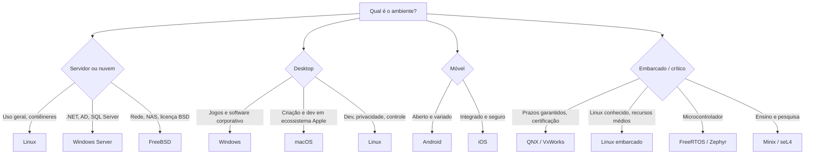

# Comparativo Final de Sistemas Operacionais

## Resumo

Não existe "melhor SO": cada um otimiza um conjunto de **requisitos** (compatibilidade, desempenho, segurança, previsibilidade, abertura, energia). Esta nota consolida arquitetura, prós, contras e casos de uso. Para arquiteturas, veja [[Comparação de Arquiteturas com Exemplos Reais]].

## Visão geral

| SO | Arquitetura | Licença | Plataformas | Principal uso |
|---|---|---|---|---|
| [[Linux]] | Monolítico modular | GPLv2 | Servidor, desktop, embarcado, nuvem, mobile (Android) | Servidores e nuvem |
| [[Windows NT]] | Híbrido | Proprietária | PC, servidor, Xbox, nuvem Azure | Desktop corporativo e jogos |
| [[macOS e XNU]] | Híbrido (Mach+BSD) | Proprietária (Darwin aberto) | Mac | Desktop criativo e desenvolvimento |
| [[FreeBSD]] | Monolítico modular | BSD | Servidor, appliances | Rede e armazenamento |
| [[Minix]] | Microkernel | BSD | PC, ARM, ME | Ensino e pesquisa |
| [[QNX]] | Microkernel RT | Comercial | Embarcado, automotivo | Sistemas críticos |
| [[Android]] | Linux + framework | Apache/GPL (AOSP) | Mobile, TV, carro | Mobile aberto |
| [[iOS]] | XNU | Proprietária | iPhone, iPad, Watch | Mobile integrado |

## Prós e contras resumidos

| SO | Prós | Contras |
|---|---|---|
| **Linux** | Aberto, escalável, estável, configurável, ecossistema DevOps | Fragmentação, suporte a hardware proprietário e a apps comerciais desktop |
| **Windows** | Compatibilidade, jogos, AD/Office, ferramentas | Custo, alvo de malware, legado, atualizações e telemetria |
| **macOS** | UNIX polido, Apple Silicon, segurança, integração | Hardware restrito, custo, personalização limitada |
| **FreeBSD** | Coeso, ZFS/jails/pf, licença permissiva, rede excelente | Menos hardware e software, comunidade menor |
| **Minix** | Confiabilidade, kernel minúsculo, didático | Sem uso geral, pouco software e hardware |
| **QNX** | Determinismo, isolamento, certificações | Custo, ecossistema menor, código fechado |
| **Android** | Aberto, diversidade, baixo custo, apps | Fragmentação de atualizações, privacidade, qualidade variável |
| **iOS** | Segurança, atualizações, desempenho consistente | Fechado, controle da Apple, custo |

## Critérios técnicos (nota relativa)

| Critério | Linux | Windows | macOS | FreeBSD | Minix | QNX | Android | iOS |
|---|---|---|---|---|---|---|---|---|
| Desempenho em servidor | Muito alto | Alto | Médio | Muito alto | Baixo | Médio | n/a | n/a |
| Compatibilidade de apps desktop | Média | **Muito alta** | Alta | Baixa | Muito baixa | Baixa | n/a | n/a |
| Suporte a hardware | Muito alto | **Muito alto** | Restrito (Apple) | Médio | Baixo | Selecionado | Alto (SoCs ARM) | Apple apenas |
| Isolamento de falhas de drivers | Baixo | Baixo/médio | Médio (DriverKit) | Baixo | **Muito alto** | **Muito alto** | Médio | Médio/alto |
| Tempo real | Médio (PREEMPT_RT) | Baixo | Baixo | Baixo | Médio | **Muito alto** | Baixo | Baixo |
| Facilidade de uso desktop | Média | Alta | **Muito alta** | Baixa | Muito baixa | n/a | Alta | **Muito alta** |
| Personalização | **Muito alta** | Média | Baixa | Alta | Alta | Alta | Alta | Baixa |
| Custo | Gratuito | Pago | Embutido no hardware | Gratuito | Gratuito | Pago | Embutido / gratuito | Embutido |
| Segurança por padrão | Alta (config.) | Alta (recente) | Alta | Alta | Alta | Alta | Média/alta | **Muito alta** |

## Que SO escolher? (árvore de decisão)

## Casos de uso lado a lado

| Cenário | Escolha típica | Motivo |
|---|---|---|
| Hospedar site com contêineres | Linux | Ecossistema, desempenho, custo |
| Estação de trabalho corporativa com AD | Windows | Gestão central, Office, compatibilidade |
| Edição de vídeo e desenvolvimento iOS | macOS | Apple Silicon, Xcode, Final Cut |
| Firewall e roteador | FreeBSD (pfSense/OPNsense) | pf, pilha de rede |
| Cockpit digital de carro | QNX / Android Automotive / Linux | Certificação, latência, ecossistema |
| Smartphone de baixo custo | Android | Aberto, hardware variado |
| Aula de SO | Minix, xv6, Linux | Código legível, didático |
| Servidor de arquivos com integridade | FreeBSD/Linux com ZFS | Checksums e snapshots |

## Dicas para escolher

> [!tip] Critérios práticos
> 1. Qual **software** precisa rodar? (compatibilidade decide a maioria das escolhas)
> 2. Qual o **modelo de segurança** e a **política de atualização** exigidos?
> 3. Existem **requisitos de tempo real ou certificação**?
> 4. **Custo total** (licença, suporte, treinamento, hardware).
> 5. Competência da **equipe**.

## Pontos-chave

- Arquitetura explica metade das diferenças; ecossistema explica a outra metade.
- Linux domina servidores/nuvem/embarcados; Windows, o desktop corporativo; macOS e iOS, o ecossistema Apple; QNX, o crítico.
- Escolha pelo requisito, não pela preferência.

## Veja também

[[MOC - Sistemas Operacionais Reais]] · [[Comparação de Arquiteturas com Exemplos Reais]] · [[Tipos de Sistemas Operacionais]]
