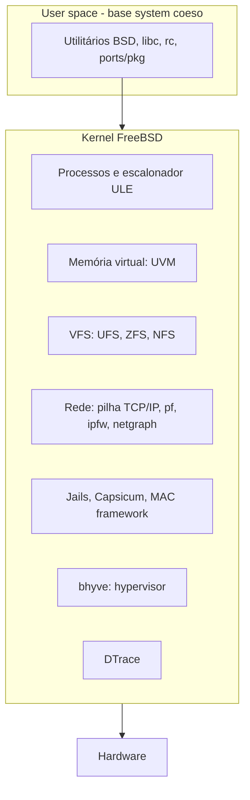

# FreeBSD

## Resumo

O **FreeBSD** é um SO UNIX completo descendente do **BSD** de Berkeley, com **kernel monolítico modular** e **userland próprio**, desenvolvido como **um único sistema coeso** (kernel, libc, utilitários e documentação no mesmo repositório). Licença **BSD** (permissiva). Influenciou macOS/iOS e é base do Netflix Open Connect (CDN), PlayStation, pfSense/OPNsense e TrueNAS CORE.

## Arquitetura



## Diferenciais

| Recurso | Descrição |
|---|---|
| **Jails** | Contêineres maduros (desde 2000), anteriores aos namespaces do Linux |
| **ZFS nativo** | Integrado ao sistema e boot por ZFS (*boot environments* com `bectl`) |
| **pf** | Firewall do OpenBSD portado; NAT e filtragem poderosos |
| **DTrace** | Rastreamento dinâmico |
| **bhyve** | Hypervisor tipo 1 do kernel |
| **Capsicum** | Capabilities para sandboxing |
| **Ports e pacotes** | `ports` compila da fonte; `pkg` binários |
| **Pilha de rede** | Reconhecida por desempenho e estabilidade (Netflix: >400 Gbps por servidor) |
| **Documentação** | FreeBSD Handbook muito completo |

## Ferramentas

```sh
freebsd-version -kru                     # versões do kernel/userland
sysctl hw.model hw.ncpu hw.physmem
service -e                               # serviços habilitados (rc.d)
sysrc sshd_enable=YES                    # configura /etc/rc.conf
pkg install nginx; pkg audit -F          # pacotes e vulnerabilidades
zpool status; zfs list; bectl list       # ZFS e boot environments
jail -c name=web path=/jails/web host.hostname=web ip4.addr=10.0.0.5 command=/bin/sh
jls                                      # lista jails
top -P; vmstat 1; gstat                  # monitoramento (gstat: E/S de GEOM)
dtrace -n 'syscall:::entry { @[execname] = count(); }'
```

## Vantagens e desvantagens

| Vantagens | Desvantagens |
|---|---|
| Sistema coeso, estável e bem documentado | Menos hardware e drivers (Wi-Fi, GPU, laptops) |
| Licença BSD permissiva (usada em produtos comerciais) | Menos software pré-compilado e menor comunidade que Linux |
| ZFS, jails, pf e DTrace maduros e integrados | Sem Docker nativo (Linux ABI parcial e jails) |
| Excelente desempenho de rede e armazenamento | Menos presença em nuvem e suporte de fornecedores |
| Atualizações previsíveis e *boot environments* | Curva para quem vem do Linux |

## Casos de uso

Firewalls/roteadores (pfSense, OPNsense), NAS (TrueNAS CORE), CDNs e servidores de alto tráfego, appliances embarcados, pesquisa em SOs, ambientes que exigem licença permissiva.

## Família BSD

OpenBSD (segurança: `pledge`/`unveil`, OpenSSH), NetBSD (portabilidade), DragonFly BSD (HAMMER, SMP), e derivados como Darwin.

## Pontos-chave

- Sistema BSD completo, com kernel monolítico modular.
- Jails, ZFS, pf, DTrace e bhyve são diferenciais.
- Ótimo para rede e armazenamento; hardware desktop menos suportado.

## Veja também

[[Kernel Monolítico]] · [[ZFS]] · [[Comparativo Final de Sistemas Operacionais]] · [[MOC - Sistemas Operacionais Reais]]
