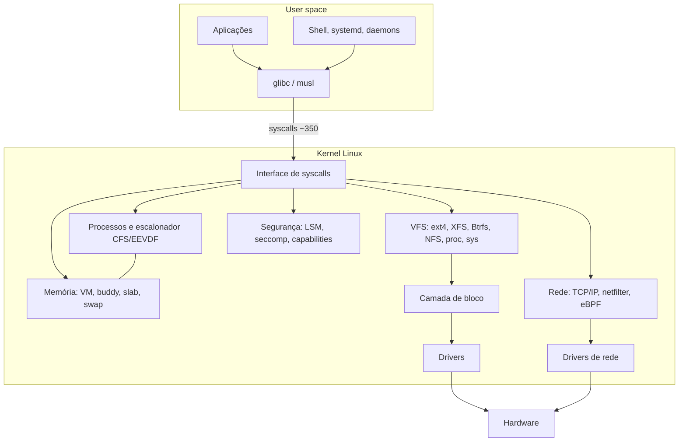

# Linux

## Resumo

**Linux** é um **kernel monolítico modular** criado por Linus Torvalds em 1991, licenciado sob **GPLv2**. Junto com utilitários GNU e outros componentes forma **distribuições** (Debian, Ubuntu, Fedora, RHEL, Arch, Alpine...). Domina servidores, nuvem, supercomputação, embarcados e, via [[Android]], celulares.

## Arquitetura



## Componentes-chave

| Área | Tecnologia |
|---|---|
| Escalonador | CFS (até 6.5) → **EEVDF**; classes `rt`, `deadline` ([[CFS - Completely Fair Scheduler]]) |
| Memória | Paginação sob demanda, THP, KSM, cgroups, OOM killer ([[Memória Virtual]]) |
| Sistemas de arquivos | [[ext4]], XFS, [[Btrfs]], F2FS, [[ZFS]] (externo), NFS ([[VFS - Virtual File System]]) |
| Rede | Pilha TCP/IP, **netfilter/nftables**, **XDP**, **eBPF** |
| Isolamento | [[Namespaces do Linux - SO]], [[cgroups - SO]], seccomp, SELinux/AppArmor ([[SELinux e AppArmor]]) |
| Virtualização | KVM ([[Hypervisors]]) |
| Init | systemd (maioria) ([[Init e systemd]]) |
| Extensão | Módulos, eBPF, Rust em drivers |

## Ciclo de desenvolvimento

- Versões a cada ~9-10 semanas; **LTS** mantidas por anos (6.6, 6.12...).
- Árvore principal de Torvalds; subsistemas por mantenedores.
- Códigos: ~35 milhões de linhas; milhares de colaboradores.

## Ferramentas nativas (principais)

`ps`, `top`/`htop`, `strace`, `lsof`, `free`, `vmstat`, `iostat`, `dmesg`, `journalctl`, `systemctl`, `mount`, `df`, `du`, `chmod`/`chown`, `grep`, `awk`, `sed`, `cron`, `ss`/`ip`. Ver [[MOC - Ferramentas Nativas do Linux]].

## Exemplo prático

```bash
uname -srm                          # versão do kernel e arquitetura
cat /etc/os-release                 # distribuição
nproc; free -h; lsblk               # visão de hardware
ls /proc | head                     # pseudo-FS com estado do kernel
sudo sysctl -a | wc -l              # parâmetros ajustáveis do kernel
zcat /proc/config.gz | grep -E "CONFIG_PREEMPT|CONFIG_HZ="   # opções de compilação
```

## Vantagens e desvantagens

| Vantagens | Desvantagens |
|---|---|
| Código aberto, gratuito, auditável | Fragmentação de distribuições e gerenciadores de pacotes |
| Desempenho, escalabilidade e estabilidade em servidores | Suporte desigual a hardware proprietário (GPU, Wi-Fi, periféricos) |
| Altamente configurável; da nuvem ao embarcado | Menos software comercial desktop (Adobe, parte de jogos) |
| Segurança em camadas e correções rápidas | Curva de aprendizado; configuração manual |
| Ecossistema de contêineres e DevOps | API de drivers internos instável (drivers fora da árvore quebram) |
| Comunidade e documentação enormes | Kernel monolítico: bug em driver afeta todo o sistema |

## Casos de uso

Servidores web e bancos de dados, nuvem e contêineres, supercomputadores (100% do TOP500), roteadores e IoT, Android, estações de desenvolvimento, SteamOS/Steam Deck.

## Pontos-chave

- Kernel monolítico modular com GPL.
- Distribuições adicionam userland, pacotes e política.
- Força em servidores, nuvem e embarcados.

## Veja também

[[Kernel Monolítico]] · [[Comparativo Final de Sistemas Operacionais]] · [[MOC - Sistemas Operacionais Reais]]
