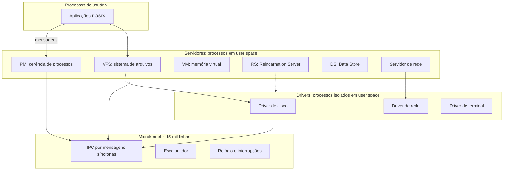

# Minix

## Resumo

O **Minix** (Andrew Tanenbaum, 1987) é um SO **tipo UNIX** com **arquitetura de microkernel**, criado para **ensino** (livro *Operating Systems: Design and Implementation*). Inspirou Linus Torvalds a criar o Linux (e o famoso debate de 1992). O **Minix 3** (2005) foca em **confiabilidade, segurança e autorreparo**. Versões do Minix rodam no **Intel Management Engine** de bilhões de CPUs.

## Arquitetura (Minix 3)



## Princípios

- **Isolamento**: cada driver e servidor é um processo com seu espaço de endereços e **privilégios mínimos** (lista de syscalls, portas de E/S e IRQs permitidas, verificadas pelo kernel).
- **Reincarnation Server (RS)**: monitora servidores e drivers; se algum **falha ou trava**, é reiniciado, sem derrubar o sistema (*autocura*).
- **IPC síncrono** por mensagens de tamanho fixo (`send`, `receive`, `sendrec`).
- **Kernel minúsculo**: ~15 mil linhas (Linux tem dezenas de milhões), mais fácil de auditar.
- Compatibilidade com **POSIX** e pacotes **NetBSD** (pkgsrc), userland BSD.

## Exemplo conceitual

```c
// Cliente envia mensagem ao servidor de arquivos (estilo Minix)
message m;
m.m_type = VFS_OPEN;
strcpy(m.m_lc_vfs_path.name, "/etc/passwd");
_syscall(VFS_PROC_NR, VFS_OPEN, &m);   // sendrec: envia e espera resposta
int fd = m.m_type;                      // descritor devolvido
```

No sistema (requer Minix 3):

```sh
service up /service/e1000 -dev /dev/eth0     # inicia driver de rede
service down e1000                           # para
ps -ax                                       # servidores e drivers aparecem como processos
kill -9 <pid do driver de rede>              # RS o reinicia automaticamente
```

## Vantagens e desvantagens

| Vantagens | Desvantagens |
|---|---|
| Altíssima confiabilidade: falhas de driver são contidas e corrigidas | Desempenho inferior (mensagens e trocas de contexto) |
| Kernel pequeno e auditável | Pouquíssimo hardware e software suportados |
| Excelente para ensino e pesquisa | Comunidade e desenvolvimento reduzidos |
| Princípio do menor privilégio por componente | Não é opção para desktop ou servidor de uso geral |

## Casos de uso

Ensino de SO, pesquisa em tolerância a falhas, referência de microkernel, Intel ME (firmware). Para produção, microkernels equivalentes: [[QNX]], seL4.

## Pontos-chave

- Microkernel com drivers e servidores em user space e **autorreparo**.
- Origem do debate microkernel x monolítico com o [[Linux]].
- Ferramenta pedagógica, referência de confiabilidade.

## Veja também

[[Microkernel]] · [[QNX]] · [[Comparativo Final de Sistemas Operacionais]] · [[MOC - Sistemas Operacionais Reais]]
