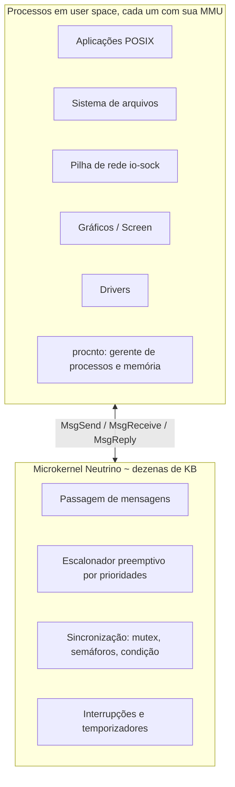

# QNX

## Resumo

O **QNX Neutrino** é um **RTOS comercial** (BlackBerry) de **microkernel**, POSIX, usado onde **confiabilidade e determinismo** são críticos: **automotivo** (infotainment e cockpit digital, ADAS), **industrial**, **robótica**, **médico** e **energia**. Há versões certificadas para segurança funcional (**ISO 26262 ASIL D**, IEC 61508 SIL 3, IEC 62304).

## Arquitetura



## Conceitos

| Conceito | Descrição |
|---|---|
| **Mensagens síncronas** | Cliente bloqueia em `MsgSend` até o servidor responder com `MsgReply`; o **kernel herda a prioridade do cliente** no servidor (herança de prioridade natural) |
| **Escalonamento** | FIFO, RR, esporádico; 256 prioridades; preempção total |
| **Latência** | Resposta a interrupções em microssegundos, determinística |
| **Resource managers** | Qualquer serviço (FS, driver) é um processo que registra nome em `/dev/...` e responde a mensagens `open/read/write` |
| **Transparência de rede** | Mensagens funcionam entre nós (QNET): acessar `/net/nó2/dev/...` |
| **Particionamento adaptativo** | Garante fatias mínimas de CPU a grupos de processos (isolamento temporal) |
| **Hypervisor** | Suporta VMs e mistura de domínios de criticidade |
| **Alta disponibilidade** | Reinício de drivers e serviços (como no Minix), *watchdogs* |

## Exemplo

```c
// Servidor (resource manager simplificado): recebe mensagens e responde
#include <sys/neutrino.h>
#include <stdio.h>

int main(void) {
    int chid = ChannelCreate(0);
    printf("canal=%d pid=%d\n", chid, getpid());
    for (;;) {
        char buf[64];
        int rcvid = MsgReceive(chid, buf, sizeof buf, NULL);   // bloqueia até uma mensagem
        char resp[] = "ok";
        MsgReply(rcvid, 0, resp, sizeof resp);                 // desbloqueia o cliente
    }
}

// Cliente
int coid = ConnectAttach(0, pid_servidor, chid, _NTO_SIDE_CHANNEL, 0);
MsgSend(coid, "ping", 5, resposta, sizeof resposta);
```

```sh
# Ferramentas do QNX (host de desenvolvimento ou alvo)
pidin                      # processos, threads, estados e prioridades
pidin -p procnto mem       # memória
hogs                       # quem consome CPU
slog2info                  # logs do sistema
tracelogger && traceprinter    # rastreamento do kernel (instrumentação)
```

## Vantagens e desvantagens

| Vantagens | Desvantagens |
|---|---|
| Determinismo e baixa latência com isolamento | Licença comercial e custo |
| Falha de driver não derruba o sistema | Ecossistema de software menor que Linux |
| Certificações de segurança funcional | Desempenho de vazão inferior a monolíticos em E/S pesada |
| POSIX facilita portar aplicações | Código-fonte fechado (acesso mediante acordo) |
| Escala de embarcados pequenos a cockpits com GPU | Curva de aprendizado de mensagens e resource managers |

## Casos de uso

Painel de instrumentos e infotainment automotivo, ADAS e computação de borda, controladores industriais, robôs, equipamentos médicos, trens, usinas.

## Alternativas

**VxWorks** (aeroespacial), **Integrity**, **Zephyr**, **FreeRTOS** (MCUs), **seL4**, **Linux com PREEMPT_RT** (soft/firm RT).

## Pontos-chave

- Microkernel POSIX de tempo real com mensagens síncronas e herança de prioridade.
- Padrão no automotivo e em ambientes certificados.
- Combina isolamento forte com latência determinística.

## Veja também

[[Microkernel]] · [[SO de Tempo Real (RTOS)]] · [[Comparativo Final de Sistemas Operacionais]] · [[MOC - Sistemas Operacionais Reais]]
