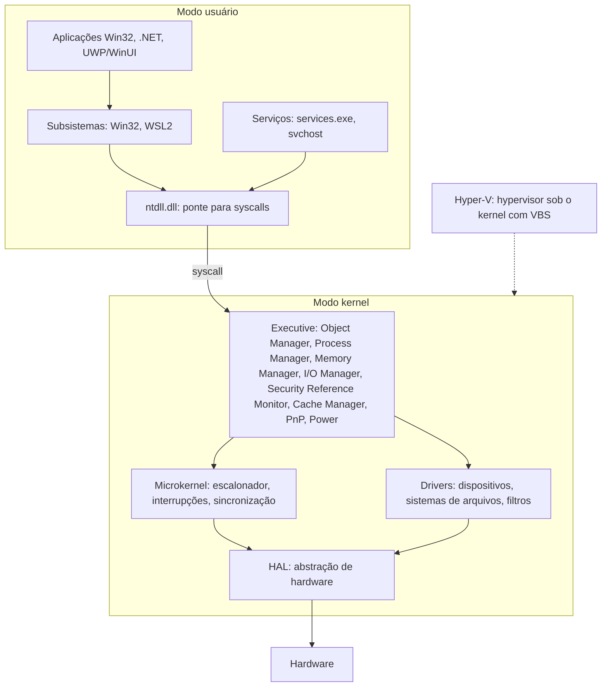

# Windows NT

## Resumo

A família **Windows NT** (1993; hoje Windows 10/11, Windows Server) tem kernel **híbrido** projetado por Dave Cutler, com influências de VMS e Mach. É o SO de desktop mais usado e dominante em ambientes corporativos, com enorme compatibilidade de software e hardware.

## Arquitetura



## Componentes essenciais

| Componente | Função |
|---|---|
| **Object Manager** | Tudo é objeto: processos, threads, arquivos, mutex, eventos, chaves do registro; acessados por **handles** |
| **Registro** | Banco hierárquico de configuração (HKLM, HKCU...) |
| **Serviços (SCM)** | Daemons gerenciados por `services.exe` |
| **Escalonador** | Prioridades 0-31 com *boosts* dinâmicos; quantum maior para o primeiro plano |
| **Gerência de memória** | Paginação com working sets, *pagefile*, *standby list*, compressão de memória |
| **NTFS / ReFS** | Sistemas de arquivos ([[NTFS]]) |
| **Segurança** | SID, tokens, ACLs, UAC, integridade, **Defender**, BitLocker, **VBS/HVCI**, Secure Boot, TPM |
| **WSL 2** | Kernel Linux real em VM leve do Hyper-V |
| **DirectX / GPU** | Pilha gráfica WDDM |

## Ferramentas nativas (principais)

Gerenciador de Tarefas, PowerShell, `cmd`, Event Viewer, Resource Monitor, Performance Monitor, `regedit`, Task Scheduler, `sfc`/`DISM`, `netstat`. Ver [[MOC - Ferramentas Nativas do Windows]].

## Exemplo prático

```powershell
Get-ComputerInfo | Select OsName, OsVersion, OsArchitecture, CsTotalPhysicalMemory
Get-Process | Sort CPU -Descending | Select -First 5 Name, Id, CPU
Get-Service | Where Status -eq Running | Measure
Get-WinEvent -LogName System -MaxEvents 5
wsl --list --verbose                      # distribuições Linux via WSL
systeminfo | findstr /B /C:"OS" /C:"System Type"
```

## Vantagens e desvantagens

| Vantagens | Desvantagens |
|---|---|
| Maior compatibilidade de software e hardware, jogos, drivers | Licença proprietária e custo (Pro/Server) |
| Ecossistema corporativo (Active Directory, Office, Intune) | Alvo principal de malware pela popularidade |
| Interface familiar, boas ferramentas de acessibilidade | Atualizações forçadas e telemetria; reinícios |
| Retrocompatibilidade excelente | Legado (registro, DLLs) aumenta complexidade |
| Boa integração de desenvolvimento (WSL2, Visual Studio) | Menor eficiência em servidores comparado ao Linux em alguns cenários |
| Segurança moderna (VBS, Defender, TPM) | Depende de drivers de terceiros (BSOD) |

## Casos de uso

Desktops corporativos e domésticos, jogos, servidores de aplicações .NET/AD/Exchange/SQL Server, estações de engenharia e design, Azure.

## Pontos-chave

- Kernel híbrido NT com Executive modular, HAL e objetos.
- Registro, serviços e Active Directory marcam o ecossistema.
- Compatibilidade é a maior força; segurança herdada, o maior desafio.

## Veja também

[[Kernel Híbrido]] · [[NTFS]] · [[Comparativo Final de Sistemas Operacionais]] · [[MOC - Sistemas Operacionais Reais]]
