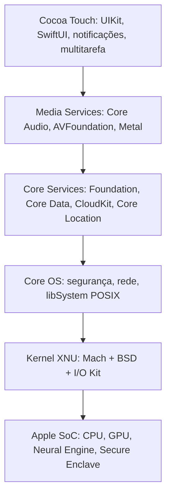

# iOS

## Resumo

O **iOS** (e variantes **iPadOS**, watchOS, tvOS, visionOS) é o SO móvel da Apple, derivado do [[macOS e XNU|macOS/Darwin]], com kernel **XNU** (híbrido). É **fechado**: roda apenas em hardware Apple e a distribuição de apps é por padrão pela **App Store** (com variações regionais, como alternativas na UE).

## Arquitetura (camadas)



## Segurança (pontos fortes)

| Mecanismo | Função |
|---|---|
| **Cadeia de boot segura** | Boot ROM → iBoot → kernel, cada estágio verificado por assinatura ([[Processo de Boot]]) |
| **Secure Enclave** | Coprocessador isolado: chaves, biometria (Face ID/Touch ID), criptografia de dados |
| **Code signing obrigatório** | Só código assinado e aprovado executa; sem JIT livre (exceções controladas) |
| **App Sandbox** | Cada app em seu contêiner; *entitlements* declaram capacidades |
| **Proteção de dados** | Criptografia por arquivo com classes de proteção ligadas ao código de acesso |
| **Permissões e App Tracking Transparency** | Consentimento por recurso |
| **Pointer Authentication (PAC), PPL, KTRR, SPTM, MIE/MTE** | Mitigações de hardware contra exploração do kernel |
| **Lockdown Mode** | Superfície de ataque reduzida para usuários de alto risco |

## Modelo de execução

- Apps têm ciclo de vida controlado: **ativo → inativo → segundo plano → suspenso → encerrado**. Em segundo plano há **tempo limitado** e *background modes* específicos (áudio, localização, push).
- **Sem swap em disco tradicional**: memória comprimida e *jetsam* (encerra apps sob pressão).
- **XPC** e extensões de app para isolamento de privilégios.
- Memória unificada e eficiência energética por *QoS*.

## Ferramentas e inspeção

```bash
# No Mac conectado ao dispositivo (ou usando Xcode / Instruments)
xcrun xctrace list devices
xcrun devicectl list devices            # gerenciamento do dispositivo (Xcode 15+)
idevice_id -l; ideviceinfo | head       # libimobiledevice (código aberto)
idevicesyslog | head                    # logs
```

Para desenvolvedores: **Xcode**, **Instruments** (CPU, memória, energia), Console, `lldb`, TestFlight.

## Vantagens e desvantagens

| Vantagens | Desvantagens |
|---|---|
| Atualizações rápidas e longas para todos os dispositivos compatíveis | Ecossistema fechado; pouca personalização |
| Segurança e privacidade fortes por design | Distribuição de apps controlada pela Apple (taxas, regras) |
| Integração hardware-software, desempenho consistente | Menos flexibilidade para usuários avançados (sem acesso livre ao sistema) |
| Ecossistema Apple (AirDrop, Continuity, iCloud) | Preço dos dispositivos; dependência do ecossistema |
| Acessibilidade e qualidade de apps | Reparo e interoperabilidade limitados |

## Casos de uso

Smartphones e tablets premium, wearables, realidade mista (visionOS), aplicativos corporativos com MDM, cenários de alto requisito de privacidade.

## iOS x Android (resumo)

| Critério | iOS | [[Android]] |
|---|---|---|
| Kernel | XNU (híbrido) | Linux (monolítico) |
| Abertura | Fechado | AOSP aberto |
| Atualizações | Centralizadas e rápidas | Dependem do fabricante |
| Distribuição de apps | App Store (regras rígidas) | Play Store + alternativas |
| Hardware | Apple apenas | Muitos fabricantes |

## Pontos-chave

- XNU em dispositivos móveis, com segurança fortemente ancorada em hardware.
- Sandbox, code signing e ciclo de vida restrito definem o modelo.
- Equilíbrio: segurança e consistência x abertura e personalização.

## Veja também

[[macOS e XNU]] · [[SO Mobile]] · [[Android]] · [[Comparativo Final de Sistemas Operacionais]] · [[MOC - Sistemas Operacionais Reais]]
