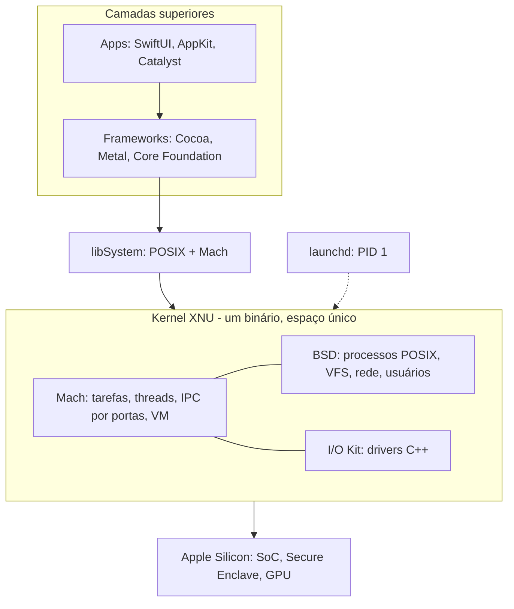

# macOS e XNU

## Resumo

O **macOS** é o SO de desktop da Apple, baseado em **Darwin** (código aberto), cujo kernel é o **XNU** (*X is Not Unix*), um **híbrido** que combina o **microkernel Mach**, a camada **BSD** (FreeBSD) e o **I/O Kit** (drivers em C++). É certificado **UNIX** (Single UNIX Specification). Roda em **Apple Silicon (ARM)** e, legado, Intel.

## Arquitetura



## Componentes e conceitos

| Elemento | Descrição |
|---|---|
| **Mach ports** | IPC por mensagens entre tarefas; base de XPC |
| **launchd** | Init e supervisor de daemons/agentes ([[launchd]]) |
| **XPC** | Serviços isolados por app para separação de privilégios |
| **APFS** | Sistema de arquivos CoW, snapshots, criptografia ([[APFS]]) |
| **Grand Central Dispatch (GCD)** | Concorrência por filas; QoS classes |
| **Segurança** | SIP, **Signed System Volume**, Gatekeeper + notarização, App Sandbox, **TCC**, XProtect, Secure Enclave, FileVault |
| **DriverKit / System Extensions** | Drivers em user space (substituem kexts) |
| **Rosetta 2** | Tradução de apps x86-64 para ARM |
| **Metal** | API gráfica e de computação da GPU |
| **Memória unificada** | CPU e GPU compartilham a mesma RAM física (Apple Silicon) |

## Ferramentas nativas (principais)

Activity Monitor, Terminal, `launchd`/`launchctl`, `diskutil`, Console, `dtrace`, `fs_usage`. Ver [[MOC - Ferramentas Nativas do macOS]].

## Exemplo prático

```bash
sw_vers                                  # versão do macOS
uname -a                                 # Darwin Kernel Version ... xnu-... RELEASE_ARM64
sysctl machdep.cpu.brand_string hw.memsize hw.ncpu
system_profiler SPHardwareDataType | head -15
launchctl list | head
csrutil status                           # SIP
spctl --status                           # Gatekeeper
sudo fs_usage -w -f filesys Finder | head   # chamadas de arquivo em tempo real
```

## Vantagens e desvantagens

| Vantagens | Desvantagens |
|---|---|
| UNIX completo com interface refinada; ótima integração com iPhone/iPad | Hardware e SO restritos ao ecossistema Apple |
| Eficiência energética e desempenho do Apple Silicon | Custo elevado; reparo e upgrades limitados |
| Segurança forte por padrão (SIP, sandbox, Secure Enclave) | Menos liberdade de personalização do sistema; jogos limitados |
| Ferramentas de desenvolvimento (Xcode, Instruments, DTrace) | Menor participação em servidores e nuvem |
| Excelente para criação (áudio, vídeo, design) | Decisões de plataforma (notarização, kexts descontinuados) impostas pela Apple |

## Casos de uso

Desenvolvimento (iOS/macOS, web), design e produção de mídia, uso profissional e doméstico premium, estações com Unix completo.

## Pontos-chave

- XNU = Mach + BSD + I/O Kit em um único kernel.
- Segurança em camadas e drivers migrando para user space.
- Forte integração hardware-software no Apple Silicon.

## Veja também

[[Kernel Híbrido]] · [[iOS]] · [[Comparativo Final de Sistemas Operacionais]] · [[MOC - Sistemas Operacionais Reais]]
