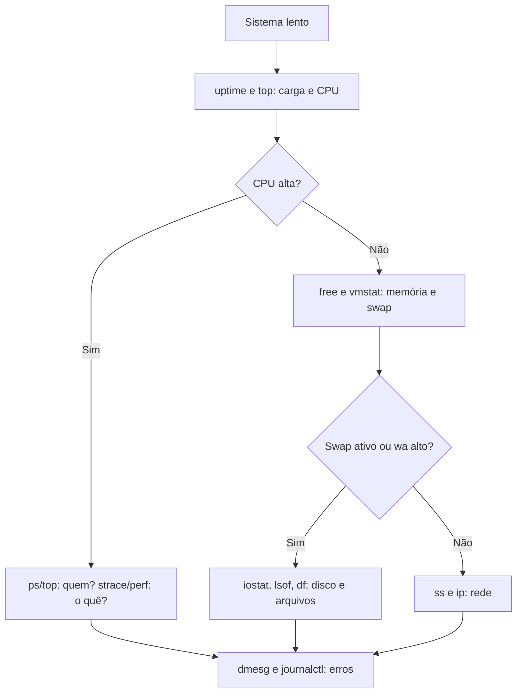

# MOC - Ferramentas Nativas do Linux

> [!info] Como usar esta pasta
> Cada nota traz: **finalidade**, **sintaxe**, **exemplos** e **saída comentada**. As ferramentas estão agrupadas pelo problema que resolvem.

## Processos e CPU

| Ferramenta | Finalidade |
|---|---|
| [[ps]] | Foto instantânea dos processos |
| [[top e htop]] | Monitor interativo de processos |
| [[strace]] | Rastrear system calls |
| [[lsof]] | Arquivos e sockets abertos por processo |

## Memória e disco

| Ferramenta | Finalidade |
|---|---|
| [[free]] | Uso de memória e swap |
| [[vmstat]] | Memória, swap, E/S, CPU e trocas de contexto |
| [[iostat]] | Desempenho de dispositivos de E/S |
| [[df e du]] | Uso de espaço em sistemas de arquivos e diretórios |
| [[mount]] | Montar e listar sistemas de arquivos |

## Logs e serviços

| Ferramenta | Finalidade |
|---|---|
| [[dmesg]] | Mensagens do kernel |
| [[journalctl]] | Logs do systemd |
| [[systemctl]] | Gerenciar serviços e unidades |
| [[cron]] | Agendamento de tarefas |

## Permissões e texto

| Ferramenta | Finalidade |
|---|---|
| [[chmod e chown]] | Permissões e propriedade |
| [[grep]] | Buscar padrões |
| [[awk]] | Processar texto por campos |
| [[sed]] | Editar fluxos de texto |

## Rede

| Ferramenta | Finalidade |
|---|---|
| [[ss]] | Sockets e conexões |
| [[ip]] | Interfaces, endereços e rotas |

## Roteiro de diagnóstico (USE: Utilização, Saturação, Erros)

## Outros SOs

[[MOC - Ferramentas Nativas do Windows]] · [[MOC - Ferramentas Nativas do macOS]] · [[Linux]]
