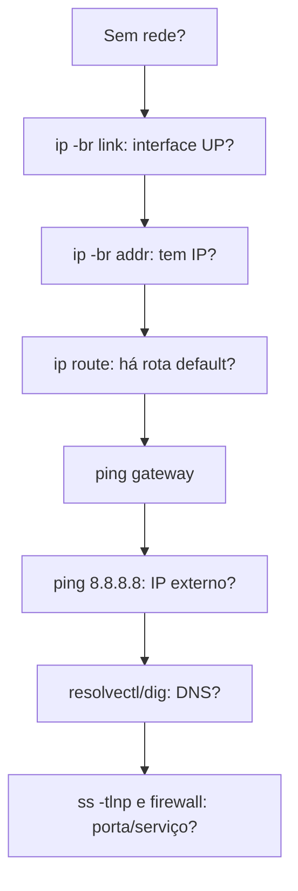

# ip

## Finalidade

Ferramenta do pacote **iproute2** para configurar e inspecionar **interfaces, endereços, rotas, vizinhança (ARP/NDP), túneis e namespaces de rede**. Substitui `ifconfig`, `route`, `arp`.

## Sintaxe geral

```bash
ip [opções] OBJETO COMANDO
# Objetos: link, addr (address), route, neigh, rule, netns, tunnel, maddr, monitor
# Opções úteis: -c (cores), -br (resumo), -s (estatísticas), -4/-6, -j (JSON)
```

## Interfaces e endereços

```bash
ip -br link                          # estado resumido das interfaces
ip -br addr                          # endereços IP resumidos
ip addr show dev eth0
ip -s link show eth0                 # contadores: pacotes, erros, descartes
sudo ip link set eth0 up|down
sudo ip link set eth0 mtu 9000
sudo ip addr add 192.168.1.50/24 dev eth0
sudo ip addr del 192.168.1.50/24 dev eth0
sudo ip link add br0 type bridge     # bridge;  also: veth, vlan, bond, wireguard
sudo ip link add link eth0 name eth0.100 type vlan id 100
```

Saída comentada:

```text
$ ip -br addr
lo      UNKNOWN  127.0.0.1/8 ::1/128
eth0    UP       192.168.1.10/24 fe80::a00:27ff:fe4e:66a1/64
docker0 DOWN     172.17.0.1/16
# UP = ativa; endereços IPv4/IPv6 com prefixo
```

## Rotas

```bash
ip route                              # tabela de roteamento
ip route get 8.8.8.8                  # qual rota/interface será usada
sudo ip route add 10.10.0.0/16 via 192.168.1.1 dev eth0
sudo ip route add default via 192.168.1.1
sudo ip route del 10.10.0.0/16
ip -6 route
ip rule                               # roteamento por política
```

```text
$ ip route
default via 192.168.1.1 dev eth0 proto dhcp metric 100    # gateway padrão
192.168.1.0/24 dev eth0 proto kernel scope link src 192.168.1.10   # rede local
```

## Vizinhança (ARP/NDP)

```bash
ip neigh                               # tabela ARP / vizinhos IPv6
ip neigh show dev eth0
sudo ip neigh flush all
```

## Namespaces de rede (base de contêineres)

```bash
sudo ip netns add teste
sudo ip link add veth0 type veth peer name veth1
sudo ip link set veth1 netns teste
sudo ip netns exec teste ip addr add 10.0.0.2/24 dev veth1
sudo ip netns exec teste ip link set veth1 up
ip netns list
```

Ver [[Namespaces do Linux - SO]].

## Monitoramento

```bash
ip monitor                             # eventos de rede em tempo real
ip -s -s link show eth0                # erros detalhados
ip -j addr | jq '.[].addr_info[].local'   # JSON para scripts
```

## Diagnóstico rápido de conectividade



```bash
ip -br link; ip -br addr; ip route
ping -c2 $(ip route | awk '/default/ {print $3}')    # gateway
ping -c2 8.8.8.8
resolvectl status; dig exemplo.com
sudo nft list ruleset | head                          # firewall
```

> [!warning] Mudanças com `ip` são temporárias
> Configurações feitas com `ip` somem ao reiniciar. Para persistir use **NetworkManager** (`nmcli`), **systemd-networkd**, **netplan** ou `/etc/network/interfaces`.

## Equivalências antigas

| Antigo | Novo |
|---|---|
| `ifconfig` | `ip addr`, `ip -s link` |
| `route -n` | `ip route` |
| `arp -a` | `ip neigh` |
| `netstat` | [[ss]] |
| `iptunnel`, `vconfig` | `ip tunnel`, `ip link add type vlan` |

## Pontos-chave

- `ip -br addr`, `ip route` e `ip -s link` são o kit de diagnóstico de rede.
- `ip route get` mostra a decisão real de roteamento.
- Alterações são voláteis: persista pela ferramenta de rede da distribuição.

## Veja também

[[ss]] · [[Namespaces do Linux - SO]] · [[MOC - Ferramentas Nativas do Linux]]
