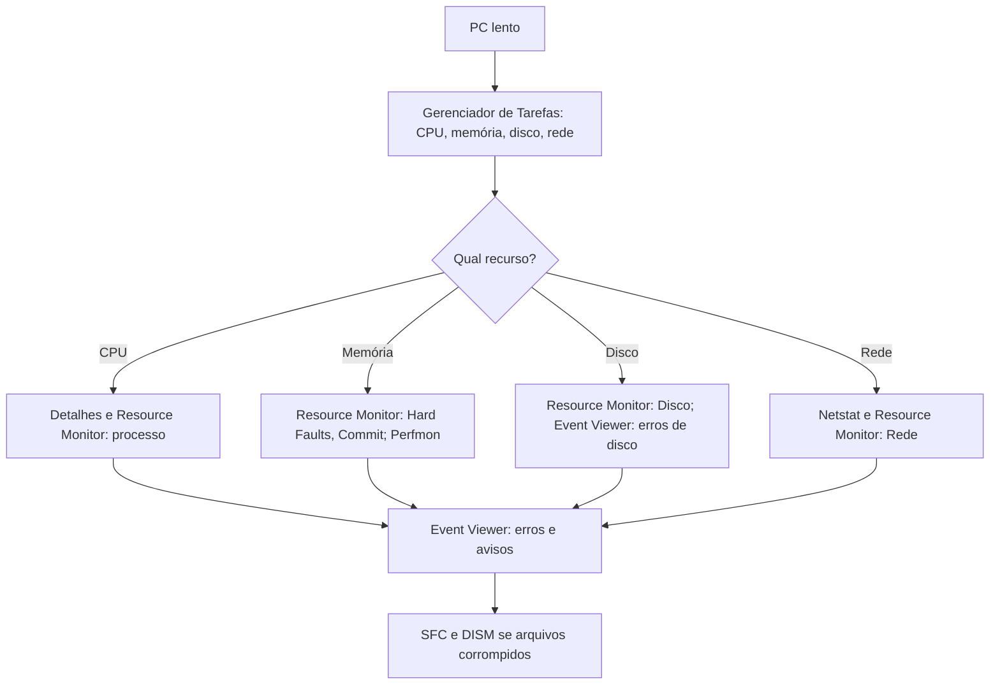

# MOC - Ferramentas Nativas do Windows

> [!info] Como usar esta pasta
> Cada nota traz **finalidade**, **como abrir**, **sintaxe/uso**, **exemplos** e **saída comentada**. Equivalentes Linux em [[MOC - Ferramentas Nativas do Linux]].

## Ferramentas

| Ferramenta | Finalidade | Atalho/comando para abrir |
|---|---|---|
| [[Gerenciador de Tarefas]] | Processos, desempenho, inicialização, serviços | `Ctrl+Shift+Esc`, `taskmgr` |
| [[PowerShell]] | Shell orientado a objetos e automação | `pwsh`, `powershell` |
| [[cmd (Prompt de Comando)]] | Interpretador de comandos clássico | `cmd` |
| [[Event Viewer (Visualizador de Eventos)]] | Logs do sistema e aplicativos | `eventvwr.msc` |
| [[Resource Monitor (Monitor de Recursos)]] | CPU, memória, disco e rede por processo | `resmon` |
| [[Perfmon (Monitor de Desempenho)]] | Contadores de desempenho e coletores | `perfmon` |
| [[Regedit (Editor do Registro)]] | Editor do Registro | `regedit` |
| [[Task Scheduler (Agendador de Tarefas)]] | Tarefas agendadas | `taskschd.msc` |
| [[SFC e DISM]] | Reparo de arquivos e imagem do sistema | `sfc`, `DISM` (admin) |
| [[netstat]] | Conexões e portas | `netstat` |

## Roteiro de diagnóstico

## Relacionados

[[Windows NT]] · [[NTFS]] · [[Permissões de Arquivos]] · [[Autenticação]]
