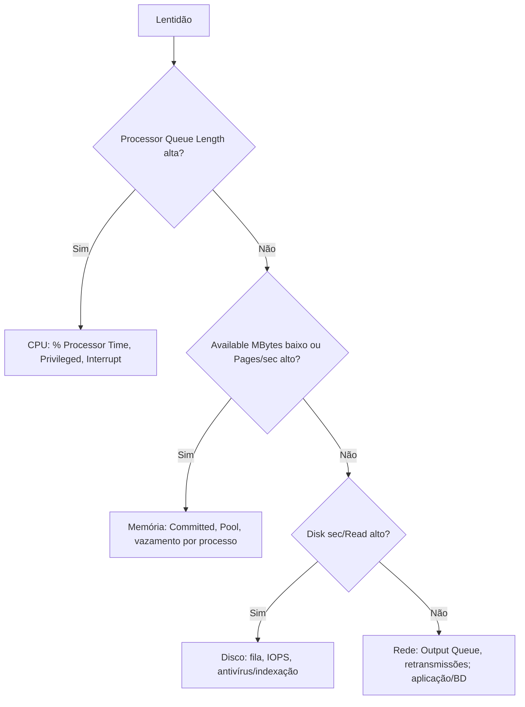

# Perfmon (Monitor de Desempenho)

## Finalidade

Coleta e exibe **contadores de desempenho** (CPU, memória, disco, rede, .NET, SQL Server...) em tempo real ou gravados em **conjuntos de coletores de dados** para análise **histórica**, linha de base e alertas. Equivale a `sar`/`vmstat`/`iostat` do Linux ([[vmstat]], [[iostat]]).

## Como abrir

`perfmon` (Monitor de Desempenho), `perfmon /res` (abre o [[Resource Monitor (Monitor de Recursos)]]), `perfmon /rel` (Monitor de Confiabilidade).

## Componentes

| Componente | Função |
|---|---|
| **Monitor de Desempenho** | Gráfico/histograma/relatório de contadores selecionados |
| **Conjuntos de Coletores de Dados** | Gravam contadores, rastreamentos de eventos (ETW) e configuração em `.blg` por agenda; geram relatórios |
| **Relatórios** | Resultado dos coletores com diagnóstico (Sistema → Diagnóstico) |
| **Alertas** | Disparam ação (tarefa, mensagem) quando um contador cruza um limite |

Estrutura de um contador: `\\Computador\Objeto(Instância)\Contador`.

## Contadores essenciais e limiares

| Contador | Limiar de atenção | Interpretação |
|---|---|---|
| `\Processor(_Total)\% Processor Time` | > 85% sustentado | CPU saturada |
| `\System\Processor Queue Length` | > 2 por núcleo | Threads esperando CPU |
| `\Processor(_Total)\% Privileged Time` | > 30% | Muito tempo em kernel/drivers |
| `\Processor(_Total)\% Interrupt Time` / `% DPC Time` | > 15% | Problema de driver/hardware |
| `\Memory\Available MBytes` | < 10% da RAM | Pouca memória |
| `\Memory\Pages/sec` | > 100 sustentado | Paginação intensa ([[Page Faults]]) |
| `\Memory\% Committed Bytes In Use` | > 80% | Risco de falta de memória virtual |
| `\Memory\Pool Nonpaged Bytes` | Crescente | Vazamento no kernel |
| `\PhysicalDisk(*)\Avg. Disk sec/Read` / `sec/Write` | > 20 ms (HDD), > 5 ms (SSD) | Latência alta |
| `\PhysicalDisk(*)\Avg. Disk Queue Length` | > 2 por eixo | Fila de disco |
| `\PhysicalDisk(*)\% Disk Time` | ~100% | Saturação (menos confiável em SSD) |
| `\Network Interface(*)\Bytes Total/sec` | Perto da capacidade do enlace | Rede saturada |
| `\Network Interface(*)\Output Queue Length` | > 2 | Fila de saída |
| `\Process(nome)\Private Bytes` / `Handle Count` | Crescente | Vazamento de memória/handles |

## Criar um coletor (gráfico)

1. `perfmon` → **Conjuntos de Coletores de Dados** → **Definido pelo Usuário** → clique direito → **Novo**.
2. **Criar manualmente** → *Contador de desempenho* → adicione contadores e intervalo (15 s).
3. Defina o **diretório** e a **agenda** (início/fim).
4. Inicie; depois abra o **Relatório** ou o arquivo `.blg`.

## Linha de comando e PowerShell

```powershell
# Amostras em tempo real
Get-Counter '\Processor(_Total)\% Processor Time','\Memory\Available MBytes' -SampleInterval 2 -MaxSamples 5

# Descobrir contadores de um objeto
Get-Counter -ListSet PhysicalDisk | Select -ExpandProperty Counter

# Exportar uma série para CSV
Get-Counter '\Processor(_Total)\% Processor Time' -SampleInterval 1 -MaxSamples 60 |
  ForEach-Object { [pscustomobject]@{ Hora=$_.Timestamp; CPU=$_.CounterSamples.CookedValue } } |
  Export-Csv cpu.csv -NoTypeInformation
```

```cmd
logman create counter BaseLinha -c "\Processor(_Total)\% Processor Time" "\Memory\Available MBytes" "\PhysicalDisk(_Total)\Avg. Disk sec/Read" -si 15 -o C:\PerfLogs\base
logman start BaseLinha
logman stop BaseLinha
typeperf "\Memory\Pages/sec" -sc 5
relog C:\PerfLogs\base_000001.blg -f csv -o base.csv
```

## Boa prática: linha de base

> [!tip] Meça antes do problema
> Colete um conjunto de contadores (CPU, memória, disco, rede) por um período normal (ex.: 1 semana). Quando houver lentidão, compare com a **linha de base**. Sem referência, "85% de CPU" não diz se é normal.

## Análise de causa



## Pontos-chave

- Contadores + coletores gravam desempenho para análise histórica.
- Latências de disco, Pages/sec e Queue Length são os indicadores mais confiáveis.
- Crie uma linha de base e automatize com `logman`/`Get-Counter`.

## Veja também

[[Resource Monitor (Monitor de Recursos)]] · [[vmstat]] · [[MOC - Ferramentas Nativas do Windows]]
