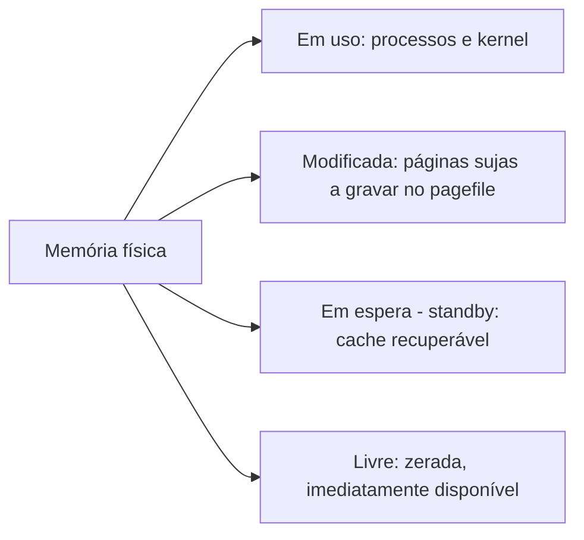

# Resource Monitor (Monitor de Recursos)

## Finalidade

Mostra, **por processo**, o uso detalhado de **CPU, memória, disco e rede**. Responde "**qual processo** está lendo o disco?", "quem está usando a rede?", "quem trava esse arquivo?". Mais profundo que o [[Gerenciador de Tarefas]].

## Como abrir

`resmon`, ou Gerenciador de Tarefas → Desempenho → *Abrir Monitor de Recursos*.

## Guias

| Guia | Informações |
|---|---|
| **Visão geral** | Gráficos resumidos e tabelas dos quatro recursos |
| **CPU** | Processos, **threads**, serviços, **Handles associados** e **Módulos associados** (DLLs); *Wait Chain* (cadeia de espera para travados) |
| **Memória** | **Hard Faults/s** por processo, Commit, Working Set, **Compartilhável**, **Privado**; barra com Reservada, Em uso, Modificada, Em espera, Livre |
| **Disco** | Arquivos lidos/escritos em tempo real por processo, **Tempo de resposta**, Comprimento da fila de disco |
| **Rede** | Atividade por processo, **conexões TCP**, **portas em escuta**, tráfego (B/s) |

## Interpretando a memória



| Indicador | Significado |
|---|---|
| **Em espera** grande | Cache bom: recuperável; faz parte da memória "disponível" |
| **Hard Faults/s** alto e contínuo | Paginação em disco ([[Page Faults|page faults maiores]]) = **falta de RAM** |
| **Commit** perto do limite | Risco de "memória virtual baixa" (RAM + pagefile) |
| **Working Set** x **Privado** | Residente x exclusivo do processo |

## Casos de uso

1. **Disco 100% ocupado**: guia **Disco** → ordene por *Total (B/s)* → veja arquivo e processo (antivírus, indexação, Windows Update, OneDrive).
2. **"Arquivo em uso"**: guia **CPU** → *Handles associados* → pesquise o nome do arquivo → identifique o processo.
3. **Aplicativo travado**: clique direito → **Analisar cadeia de espera** (quem bloqueia quem).
4. **Rede lenta ou suspeita**: guia **Rede** → *Conexões TCP* → destino, porta e processo; *Portas em escuta* → serviços expostos.
5. **Vazamento de memória**: acompanhe *Confirmar (KB)* de um processo ao longo do tempo.

## Equivalentes no PowerShell/CMD

```powershell
Get-Counter '\Memory\Pages/sec','\PhysicalDisk(_Total)\Avg. Disk Queue Length' -SampleInterval 2 -MaxSamples 3
Get-Process | Sort PM -Descending | Select -First 5 Name, Id, @{n='PrivMB';e={[int]($_.PM/1MB)}}
Get-NetTCPConnection | Where State -eq Established | Select RemoteAddress, RemotePort, OwningProcess
handle.exe arquivo.txt        # Sysinternals: quem tem o arquivo aberto
```

```cmd
netstat -ano | findstr ESTABLISHED
typeperf "\Processor(_Total)\% Processor Time" -sc 5
```

## Limitações

> [!info] Escopo
> Mostra o **estado atual** (sem histórico) e só do computador local. Para registros ao longo do tempo e alertas use o [[Perfmon (Monitor de Desempenho)]]; para rastreamento detalhado de arquivos, Process Monitor (Sysinternals).

## Pontos-chave

- Visão por processo de CPU, memória, disco e rede.
- *Hard Faults/s* contínuos indicam falta de RAM.
- *Handles associados* e *Cadeia de espera* resolvem arquivos presos e travamentos.

## Veja também

[[Gerenciador de Tarefas]] · [[Perfmon (Monitor de Desempenho)]] · [[MOC - Ferramentas Nativas do Windows]]
