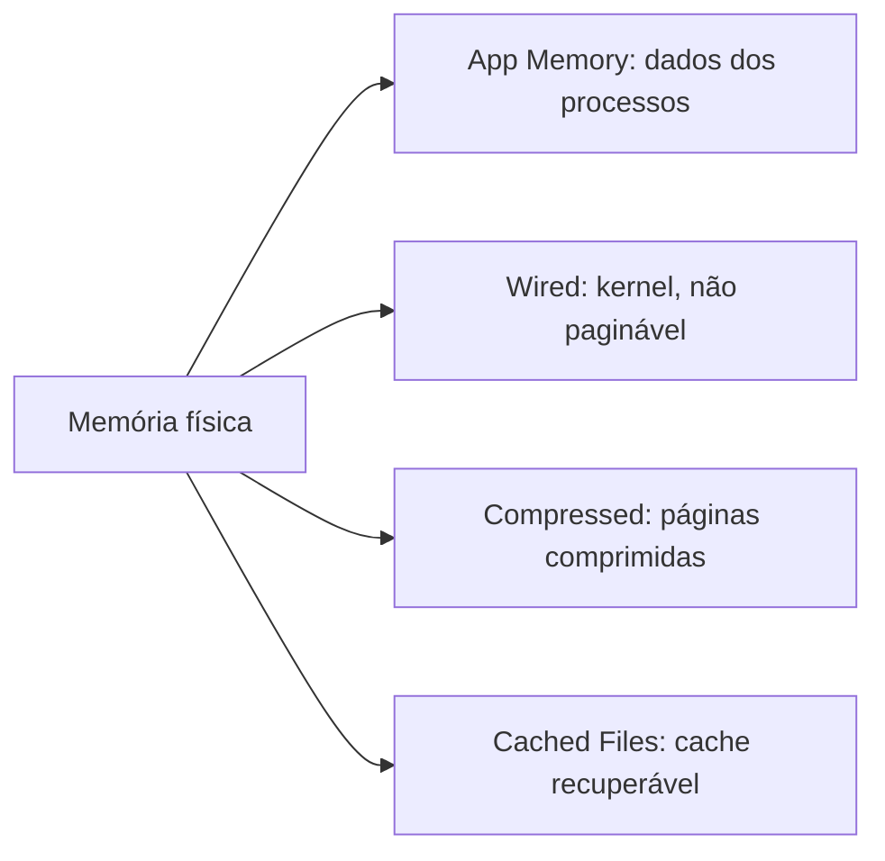

# Activity Monitor (Monitor de Atividade)

## Finalidade

Ferramenta gráfica para observar e encerrar processos e medir **CPU, memória, energia, disco e rede**. Equivalente ao [[Gerenciador de Tarefas]] do Windows e ao [[top e htop|top]].

## Abas

| Aba | O que mostra |
|---|---|
| **CPU** | % por processo, threads, *Idle Wakeups*, gráfico de carga e por núcleo (P e E em Apple Silicon) |
| **Memória** | **Pressão de memória** (verde/amarelo/vermelho), memória física, usada, em cache, *swap used*; app, com fio (*wired*), comprimida |
| **Energia** | Impacto energético por app |
| **Disco** | Leituras/escritas, bytes, IOPS |
| **Rede** | Bytes enviados/recebidos por processo |

## Interpretando a memória



> [!tip] Pressão de memória
> Mais importante que "memória livre". **Verde**: ok; **amarelo**: compressão ativa; **vermelho**: swap intenso, falta de RAM. O macOS usa **compressão de memória** antes de recorrer ao [[Swap e Thrashing]].

## Ações

- **Encerrar** (SIGTERM) e **Forçar encerramento** (SIGKILL) ([[Sinais]]).
- **Amostrar processo**: gera relatório de pilhas (`sample`).
- **Inspecionar**: arquivos abertos, portas, memória, estatísticas.
- **Executar Diagnóstico do Sistema**: `sysdiagnose` completo.

## Equivalentes no Terminal

```bash
top -o cpu -n 10                 # 10 maiores consumidores de CPU
top -o mem -l 1 | head -20       # memória, uma amostra
vm_stat                          # páginas livres, ativas, comprimidas, page-ins/outs
memory_pressure                  # estado de pressão
sysctl hw.memsize hw.ncpu        # RAM e CPUs
ps aux | sort -nrk 3 | head -5   # BSD ps
sample Safari 5                  # amostra pilhas de um processo por 5 s
sudo powermetrics --samplers cpu_power -n 1   # energia/frequência
```

Saída de `vm_stat` comentada:

```text
Pages free:                 31250.     # livres
Pages active:              410220.     # em uso recente
Pages wired down:          180000.     # kernel, fixas
Pages stored in compressor: 95000.     # comprimidas
Pageouts:                     1200.    # escritas em swap (alto = problema)
```

Tamanho de página: 16 KB em Apple Silicon, 4 KB em Intel.

## Pontos-chave

- Observe a **pressão de memória**, não a memória "livre".
- `kernel_task` alto pode indicar limitação térmica (o sistema reduz CPU).
- Para detalhe, use `sample`, [[fs_usage]] e [[dtrace]].

## Veja também

[[Terminal (zsh e utilitários)]] · [[Console e Unified Logging]] · [[MOC - Ferramentas Nativas do macOS]]
