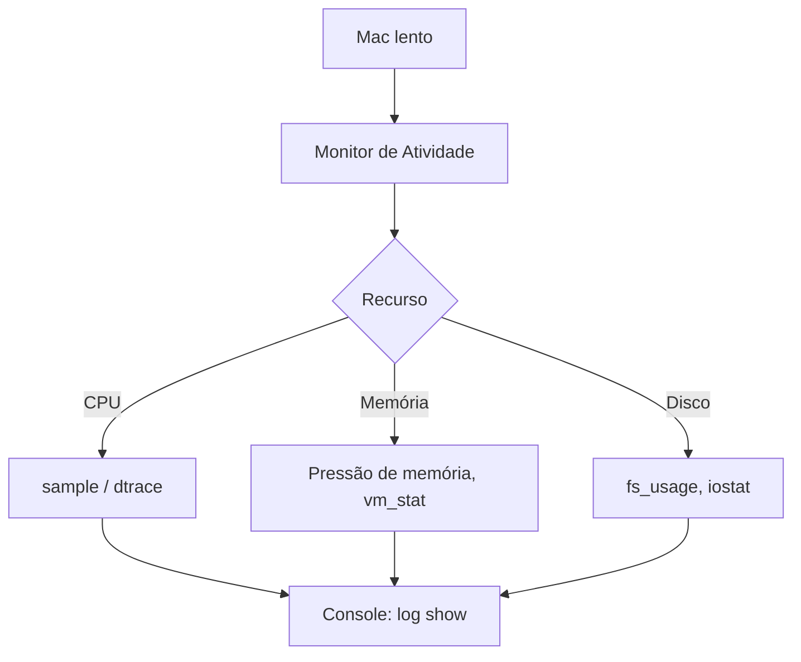

# MOC - Ferramentas Nativas do macOS

> [!info] Contexto
> O macOS é um UNIX certificado (base [[macOS e XNU|XNU]] + userland BSD). Muitos comandos coincidem com [[MOC - Ferramentas Nativas do Linux]], mas há diferenças (BSD vs GNU, `launchd` no lugar do systemd, APFS).

## Ferramentas

| Ferramenta | Finalidade | Como abrir |
|---|---|---|
| [[Activity Monitor (Monitor de Atividade)]] | Processos, CPU, memória, energia, disco, rede | Spotlight → *Monitor de Atividade* |
| [[Terminal (zsh e utilitários)]] | Shell (zsh) e utilitários UNIX | Spotlight → *Terminal* |
| [[launchd]] | Init e gerenciador de serviços/agendamento | `launchctl` |
| [[diskutil]] | Discos, volumes APFS, particionamento | `diskutil` |
| [[Console e Unified Logging]] | Logs unificados (Unified Logging) | Spotlight → *Console* |
| [[dtrace]] | Rastreamento dinâmico do kernel e apps | `sudo dtrace` |
| [[fs_usage]] | Chamadas de sistema de arquivos/rede em tempo real | `sudo fs_usage` |

## Equivalências rápidas

| Tarefa | Linux | macOS |
|---|---|---|
| Processos | `ps`, `top` | `ps`, `top -o cpu`, Monitor de Atividade |
| Serviços | `systemctl` | `launchctl` |
| Logs | `journalctl` | `log show`, Console |
| Discos | `fdisk`, `mount` | `diskutil` |
| Rastreio de syscalls | `strace` | `dtruss`, `fs_usage`, `dtrace` |
| Arquivos abertos | `lsof` | `lsof` |
| Rede | `ss`, `ip` | `netstat`, `ifconfig`, `networksetup` |

## Fluxo de diagnóstico

## Relacionados

[[macOS e XNU]] · [[APFS]] · [[iOS]] · [[Comparativo Final de Sistemas Operacionais]]
