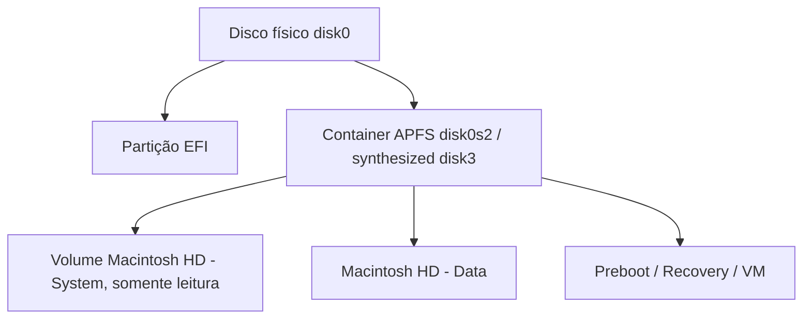

# diskutil

## Finalidade

Utilitário de linha de comando para **gerenciar discos, partições e volumes** (equivalente a `fdisk`/`parted` + `mount` + `mkfs` do Linux). A contraparte gráfica é o **Utilitário de Disco**. Opera sobre [[APFS]], HFS+, FAT/exFAT e discos externos.

## Conceitos APFS



Volumes APFS **compartilham o espaço livre** do container (sem tamanho fixo). Snapshots e clones são baratos ([[APFS]]).

## Comandos

```bash
diskutil list                         # discos, partições, volumes (identificadores diskXsY)
diskutil info disk3s1                 # detalhes: UUID, sistema de arquivos, espaço
diskutil apfs list                    # containers e volumes APFS
diskutil mount disk4s1 ; diskutil unmount /Volumes/USB ; diskutil eject disk4
diskutil verifyVolume /               # verifica o sistema de arquivos
diskutil repairVolume /Volumes/USB    # tenta reparar
diskutil apfs addVolume disk3 APFS Dados          # novo volume no container
diskutil apfs listSnapshots /                      # snapshots (Time Machine)
tmutil listlocalsnapshots /                        # snapshots locais
```

Operações **destrutivas** (confirme o identificador com `diskutil list`):

```bash
diskutil eraseDisk ExFAT PENDRIVE GPT disk4        # apaga e particiona (GPT)
diskutil eraseVolume APFS NovoNome disk4s2
diskutil partitionDisk disk4 GPT APFS Dados 50g ExFAT Troca R   # divide
diskutil secureErase freespace 0 /Volumes/Dados    # (SSD: criptografia/FileVault é o método apropriado)
```

> [!warning] Cuidado
> Confirme sempre o `diskN` correto: apagar o disco errado é irreversível. `internal`/`external` aparecem no `list`.

## Saída comentada

```text
$ diskutil list
/dev/disk0 (internal, physical):
   #:  TYPE                    NAME            SIZE       IDENTIFIER
   0:  GUID_partition_scheme                   500.3 GB   disk0
   1:  Apple_APFS_ISC          Container disk1 524.3 MB   disk0s1
   2:  Apple_APFS              Container disk3 494.4 GB   disk0s2     # container principal
/dev/disk3 (synthesized):
   1:  APFS Volume  Macintosh HD            11 GB   disk3s1s1   # sistema (snapshot selado)
   5:  APFS Volume  Data                    180 GB  disk3s5     # dados do usuário
```

## Outros utilitários

```bash
df -h                       # espaço (BSD)
du -sh * | sort -h
hdiutil create -size 1g -fs APFS -volname Cofre cofre.dmg    # imagem de disco
hdiutil attach cofre.dmg
fdesetup status             # FileVault
mount                       # montagens
```

## Pontos-chave

- `diskutil list` primeiro, sempre; identifique `diskNsM`.
- APFS: container com volumes que compartilham espaço.
- Use `verifyVolume`/`repairVolume` para checagem; `eraseDisk` é destrutivo.

## Veja também

[[APFS]] · [[mount]] · [[df e du]] · [[MOC - Ferramentas Nativas do macOS]]
