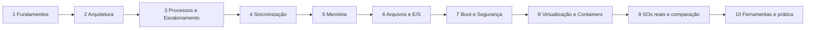

# Mapa de Estudos

## Resumo

Roteiro em 10 etapas, do básico ao avançado. Estimativa para quem estuda ~1 h por dia; ajuste ao seu ritmo.

## Visão geral

## Roteiro

| Etapa | Conteúdo | Notas de entrada | Duração | Checkpoint |
|---|---|---|---|---|
| 1 | Fundamentos | [[MOC - Fundamentos - SO]], [[O que é um Sistema Operacional]], [[System Calls]] | 1 semana | Explicar user x kernel space e o caminho de uma syscall |
| 2 | Arquitetura | [[MOC - Arquitetura de Kernels]], [[Comparação de Arquiteturas com Exemplos Reais]] | 1 semana | Comparar monolítico, microkernel e híbrido |
| 3 | Processos e escalonamento | [[MOC - Processos e Threads]], [[MOC - Escalonamento]] | 2 semanas | Simular RR e SJF à mão |
| 4 | Sincronização | [[MOC - Sincronização]] | 2 semanas | Resolver produtor-consumidor com semáforos; detectar deadlock |
| 5 | Memória | [[MOC - Gerenciamento de Memória]] | 2 semanas | Traduzir endereço com tabela de páginas; simular LRU |
| 6 | Arquivos e E/S | [[MOC - Sistemas de Arquivos]], [[MOC - Entrada e Saída]] | 2 semanas | Explicar inode, journaling x CoW |
| 7 | Boot e segurança | [[MOC - Boot]], [[MOC - Segurança - SO]] | 1 semana | Descrever o boot UEFI até o init |
| 8 | Virtualização e containers | [[MOC - Virtualização e Containers]] | 1 semana | Explicar namespaces e cgroups |
| 9 | SOs reais | [[MOC - Sistemas Operacionais Reais]], [[Comparativo Final de Sistemas Operacionais]] | 1 semana | Justificar a escolha de SO para 3 cenários |
| 10 | Ferramentas | [[MOC - Ferramentas Nativas do Linux]], [[MOC - Ferramentas Nativas do Windows]], [[MOC - Ferramentas Nativas do macOS]] | 2 semanas | Diagnosticar lentidão em cada SO |

## Trilhas por objetivo

- **Administrador de sistemas:** 1 → 3 (visão) → 5 → 6 → 7 → 8 → 10.
- **Desenvolvedor de sistemas/kernel:** 1 → 2 → 3 → 4 → 5 → 6 (todos em profundidade) e [[Linux]].
- **Segurança:** 1 → 2 → 5 → 7 ([[ASLR - Address Space Layout Randomization]], [[DEP, NX e Mitigações de Exploração]], [[Sandboxing]]) → 8.
- **Concurso/prova:** [[Glossário#Sistemas Operacionais]] + [[Exercícios com Gabarito]] + etapas 3 a 6.

## Prática sugerida

1. Monte uma VM Linux ([[Hypervisors]]) e use [[strace]] em `ls`.
2. Escreva um programa com `fork` e pipe ([[Criação e Término de Processos]], [[Pipes]]).
3. Crie uma race condition e corrija com [[Mutex]].
4. Rode um container e inspecione seus [[Namespaces do Linux - SO]] e [[cgroups - SO]].
5. Compare o mesmo diagnóstico em Linux, Windows e macOS.

## Pontos-chave

- Siga a ordem: cada etapa usa conceitos da anterior.
- Pratique em cada etapa; só ler não fixa.
- Use [[Índice Geral - SO]] para navegar por qualquer tópico.

## Veja também

[[MOC - Extras]] · [[Índice Geral - SO]]
