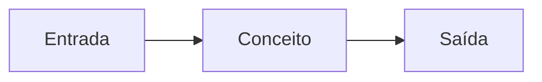

# {{title}}

## Objetivo
O que o leitor sabe fazer ou entender ao final.

## Explicação
Definição, contexto e como se encaixa no OpenClaw.



## Exemplo prático
> [!example]
> Passo a passo curto e verificável.

```bash
# comando da documentação oficial
```

## Armadilhas comuns
-

## Resumo
-

## Relacionados
- [[]]
- [[]]
- [[]]
- [[]]

## Exercícios
1.
2.
3.
