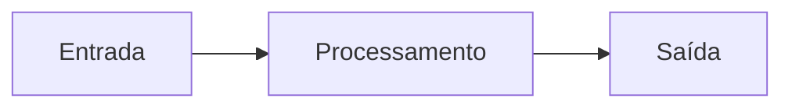

# {{title}}

## Objetivo
> O que o leitor será capaz de fazer após estudar esta nota.

## Conceito
Definição técnica, contexto e como o tema se encaixa na automação de segurança.

## Exemplo prático
> [!example] Cenário
> Descreva um caso realista e, se couber, um trecho de código com a linguagem indicada.

## Boas práticas
- 

## Erros comuns
- 

## Para revisar
> [!question] Perguntas
> 1. 
> 2. 
> 3. 

## Links relacionados
- Voltar ao MOC da pasta e à Home.
