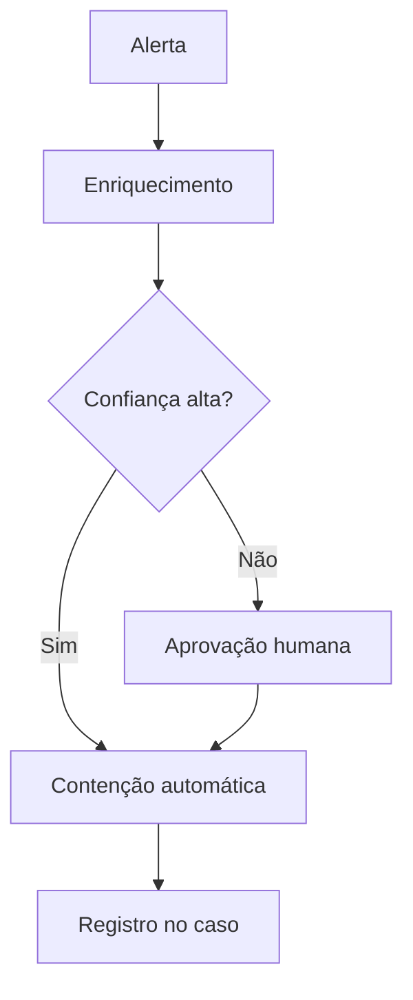

# Playbook - {{title}}

## Objetivo
Qual incidente ou alerta este playbook trata e qual resultado se espera.

## Gatilho e pré-requisitos
- Fonte do alerta:
- Severidade mínima:
- Integrações necessárias:

## Fluxo

## Etapas detalhadas
1. Triagem:
2. Enriquecimento:
3. Decisão:
4. Contenção:
5. Erradicação e recuperação:

## Pontos de aprovação humana
> [!warning] Human-in-the-loop
> Liste as ações destrutivas ou de alto impacto que exigem aprovação.

## Rollback
Como desfazer cada ação automática.

## Métricas
MTTD, MTTR e taxa de falso positivo associados.

## Boas práticas
- 

## Erros comuns
- 

## Para revisar
> [!question] Perguntas
> 1. 
> 2. 
> 3. 
